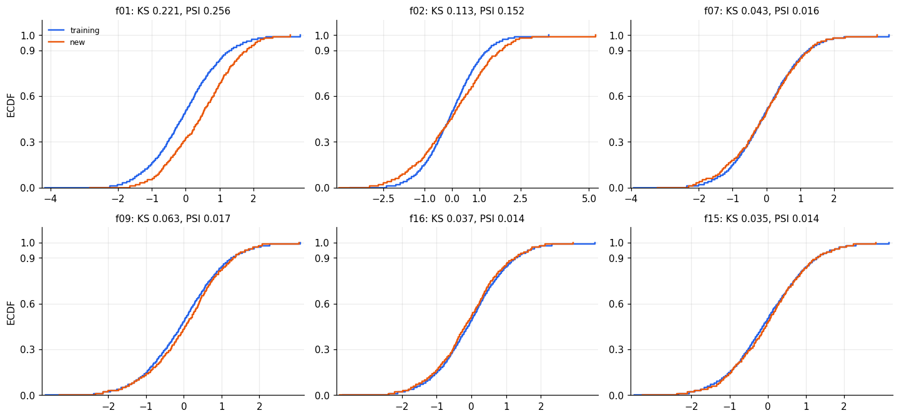
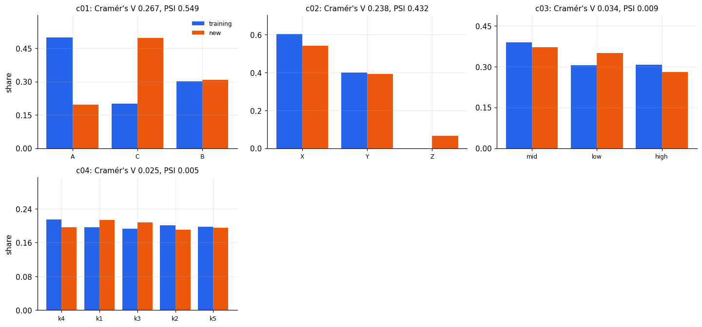
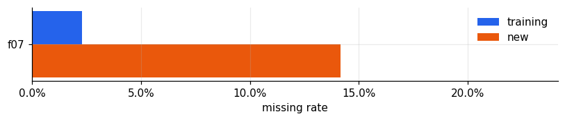
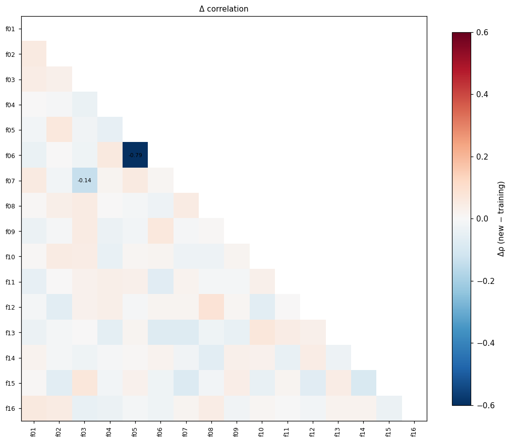
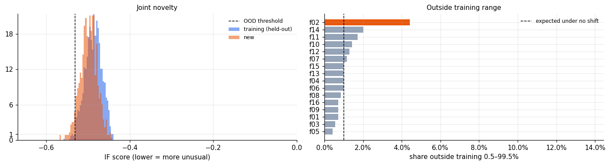
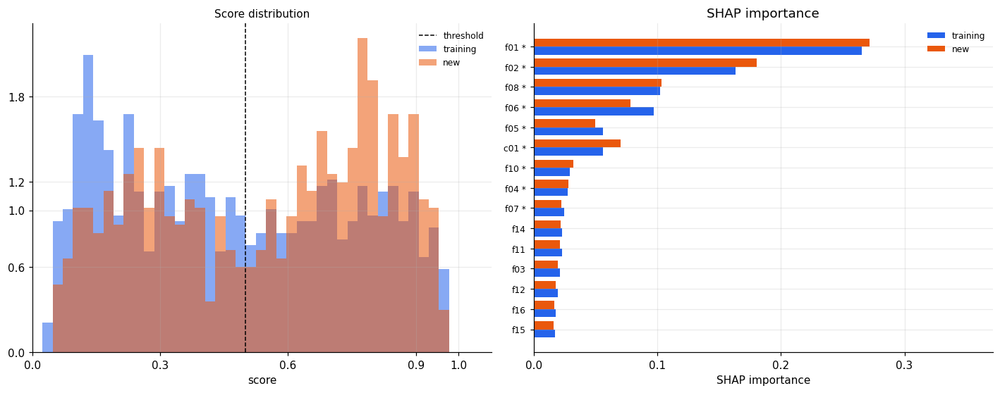
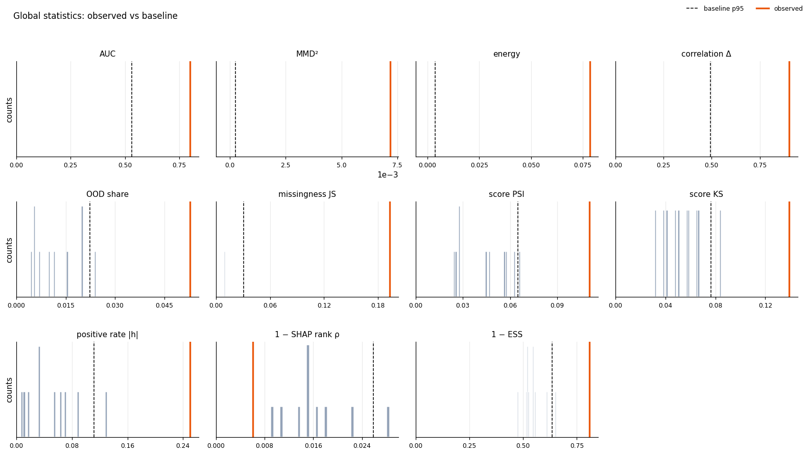

# Population drift report: is the model transferable?

Training population (4,000 rows) vs new population (700 rows) · analysis run 2026-10-22T18:35:47+00:00

## Executive summary

> **Verdict (severe):** Different: do not use the model as is
>
> severe if any severe signal; mild if no severe, ≤2 moderate and none on model-important features; moderate otherwise. Whether a given feature vector still maps to the same label cannot be assessed without labels.
Training population: **4,000** rows · New population: **700** rows · 20 features (16 continuous, 4 categorical) · Model: **yes** · Training labels: **target** · Baseline: **10** rounds of **700**-row training subsets

> **How to read this report.** Every statistic is compared with the *baseline*: the distribution of the same statistic between random subsets of the training population (pure sampling noise). That noise is computed under exchangeability inside the reference: any row can stand in for any other, so the two sides of a random split are not systematically distinguishable. The 95th percentile is the distinguishability left by the split alone. The new population exceeds it when the new population is more distinguishable from the reference than those two pieces are from each other. A difference is flagged only if it is statistically significant after multiple-testing correction, larger than the baseline 95th percentile, and at least moderate by effect-size rules of thumb. **mild** within noise or negligible · **moderate** real, moderate · **severe** real, large.

### Signals

| Level | Signal | Pair | Observed | Baseline | Detail |
|---|---|---|---|---|---|
| **severe** | Feature drift: model-important features | fit set vs new | 2 severe, 2 moderate of 9 | p95 per feature | c01 (severe), f01 (severe), f02 (moderate), f07 (moderate) |
| **severe** | Joint distribution: classifier two-sample test | fit set vs new | AUC 0.800 (permutation p=0.048) | AUC p95 0.532 | beyond baseline; top drivers: c01, f01, f02 |
| **severe** | Out-of-support rows (Isolation Forest) | fit set vs new | 5.3% of target rows (expected 1%) | out-of-support share p95 2.2% | binomial p=7.93e-16; beyond baseline |
| **moderate** | Feature drift: low-importance features | fit set vs new | 1 of 11 flagged | p95 per feature | c02 (capped at moderate: low impact) |
| **moderate** | Missing-value rates | fit set vs new | 1 feature(s) with \|h\| ≥ 0.2 | \|Cohen's h\| p95 per feature | f07 (2.3%→14.1%) |
| **moderate** | Unseen category levels | fit set vs new | 1 feature(s) > 1% of rows | Unseen-level share 1.0% | c02 (6.6%) |
| **moderate** | Joint distribution: kernel/energy tests | fit set vs new | MMD² 0.0072 (p=0.010); energy 0.0784 (p=0.010) | MMD² p95 2.7e-04 · energy distance p95 0.00372 | Permutation tests (Bonferroni over 2); moderate when significant and beyond baseline |
| **moderate** | Dependence structure (Spearman) | fit set vs new | Frobenius 0.901 (p=0.010) | Frobenius p95 0.495 | f05–f06 Δρ=-0.79 |
| **moderate** | Values outside the training range | fit set vs new | 1 feature(s) > 2× expected | outside-share p95 per feature | f02 (4.4%) |
| **moderate** | Model score distribution | evaluation set vs new | score PSI 0.110, KS D 0.139 | score PSI p95 0.065 · score KS D p95 0.0764 | beyond baseline |
| **moderate** | Predicted positive rate | evaluation set vs new | 45.1% → 57.6% | \|Cohen's h\| 0.2 | Cohen's h=0.25, p=4.16e-07 |
| **moderate** | Model attributions (SHAP) | evaluation set vs new | importance rank ρ=0.99; 3 important feature(s) with shifted SHAP | 1 − rank ρ p95 0.0259 · SHAP KS D p95 per feature | f01, f02, c01 |
| **moderate** | Population overlap (ESS) | evaluation set vs new | ESS ratio 0.19 | ESS ratio 0.5 and 0.1 | ESS 192 of 1000 source rows |
| **moderate** | Class prior (BBSE) | evaluation set vs new | 45.0% → 74.7% [63.4%–85.7%] | Source prevalence 45.0% | Recalibrate intercept/threshold if shifted. Valid only if P(x\|y) is unchanged; under covariate shift prefer the CBPE and importance-weighted estimates. |
| **mild** | Estimated performance: importance weighting | evaluation set vs new | AUC 0.844 [95% CI 0.791–0.890] vs reference 0.793 | Reference AUC 0.793; tolerance 0.02 | Tolerance 0.020; severe only if the whole CI is beyond tolerance. |
| **mild** | Estimated performance: CBPE | evaluation set vs new | AUC 0.808 [95% CI 0.799–0.817] vs reference 0.815 | Reference AUC 0.815; tolerance 0.02 | Tolerance 0.020; severe only if the whole CI is beyond tolerance. |
| **info** | Source calibration (prerequisite for CBPE) | evaluation set vs new | ECE 0.032, slope 0.89 | ECE 0.05 | Computed on the training population; optimistic if these rows were used for training. |

### Key findings
- **3** feature(s) with material drift and **2** with moderate drift out of 20; **15** are within natural variability or negligible.
- **severe** **c01** (model-important): PSI=0.549; Cramér's V=0.267; adj. p
> **Caveats**- Without labels for the new population, **concept shift** (a change in P(y|x)) cannot be detected; all performance estimates assume it is absent. Label a small random sample to verify.
> - Label-based checks use the training-population rows supplied. If these rows were used to fit the model, calibration and performance references are optimistic; prefer a labelled holdout.

## Feature-level drift

Pair: fit set vs new.

3 severe, 2 moderate and 15 mild features. Critical (large drift on a model-important feature): **c01, f01**. Model importance is the share of mean |SHAP| on the training population; drift on low-importance features rarely affects predictions.

**Baseline.** 95th percentile of PSI, KS D, and Wasserstein distance / standard deviation (SD), or PSI, Cramér's V, and Jensen–Shannon (JS) distance on 10 random splits of the fit set, each holding out 700 rows. A feature is beyond baseline when any of those statistics exceeds its own percentile.

| feature | type | severity | important | importance share | PSI | PSI p95 | KS D | SMD | Cramér's V | equivalent mean, TOST | significant | beyond baseline | reasons |
|---|---|---|---|---|---|---|---|---|---|---|---|---|---|
| c01 | categorical | **severe** | yes | 0.0558 | 0.549 | 0.00404 | – | – | 0.267 | – | yes | yes | PSI=0.549; Cramér's V=0.267; adj. p

## Continuous features

Pair: fit set vs new.

2 of 16 continuous features differ significantly (Kolmogorov–Smirnov (KS), adjusted p < α); 8 have statistically equivalent means (TOST, |SMD| < 0.1). The ECDFs show the 6 most drifted features: horizontal gaps are location shifts, different slopes are spread changes, divergence at the ends are tail changes. Significance alone is not decisive with large samples; use SMD, PSI and the baseline columns for magnitude.

**Baseline.** 95th percentile of PSI, KS D, and Wasserstein distance / SD, or PSI, Cramér's V, and JS distance on 10 random splits of the fit set, each holding out 700 rows. A feature is beyond baseline when any of those statistics exceeds its own percentile.

**Full continuous-feature table**

| feature | severity | mean_source | mean_target | smd | SMD CI low | SMD CI high | var_ratio | ks_d | KS p95 | KS p adj | AD p adj | CvM p adj | Wasserstein/SD | psi | psi_ci_low | psi_ci_high | PSI p95 | equivalent | tost_p |
|---|---|---|---|---|---|---|---|---|---|---|---|---|---|---|---|---|---|---|---|
| f01 | **severe** | -0.00141 | 0.492 | 0.496 | 0.415 | 0.577 | 0.945 | 0.221 | 0.0489 | 6.9e-25 | 0.008 | 4.3e-09 | 0.49 | 0.256 | 0.202 | 0.358 | 0.0267 | no | 1 |
| f02 | **moderate** | 0.00216 | 0.0695 | 0.0568 | -0.0235 | 0.137 | 1.84 | 0.113 | 0.0571 | 3.9e-06 | 0.008 | 1.0e-05 | 0.302 | 0.152 | 0.104 | 0.238 | 0.025 | no | 0.169 |
| f07 | **moderate** | -0.0131 | -0.0387 | -0.0256 | -0.111 | 0.0603 | 1.11 | 0.0429 | 0.0563 | 0.923 | 0.25 | 0.858 | 0.0608 | 0.016 | 0.0137 | 0.0711 | 0.0262 | yes | 0.0481 |
| f09 | **mild** | 0.00912 | 0.0829 | 0.0745 | -0.00578 | 0.155 | 0.989 | 0.0631 | 0.0582 | 0.0885 | 0.133 | 0.0604 | 0.0881 | 0.0171 | 0.0116 | 0.0625 | 0.0272 | no | 0.267 |
| f16 | **mild** | -0.00251 | -0.0718 | -0.0696 | -0.15 | 0.0107 | 1.01 | 0.0371 | 0.0519 | 0.923 | 0.25 | 0.609 | 0.0702 | 0.0138 | 0.0127 | 0.0617 | 0.0243 | no | 0.23 |
| f15 | **mild** | -0.00362 | 0.0278 | 0.0317 | -0.0486 | 0.112 | 0.977 | 0.0355 | 0.0467 | 0.923 | 0.25 | 0.858 | 0.0426 | 0.0136 | 0.0115 | 0.0671 | 0.0234 | yes | 0.0472 |
| f03 | **mild** | 1.14 | 1.14 | 0.0024 | -0.0779 | 0.0827 | 0.885 | 0.0301 | 0.0613 | 0.923 | 0.25 | 0.858 | 0.0423 | 0.0105 | 0.0102 | 0.0512 | 0.0305 | yes | 0.00754 |
| f04 | **mild** | 5.61 | 5.81 | 0.032 | -0.0483 | 0.112 | 1.03 | 0.0293 | 0.061 | 0.923 | 0.25 | 1.4e-07 | 0.0359 | 0.006 | 0.00451 | 0.0401 | 0.0285 | yes | 0.0494 |
| f11 | **mild** | -0.00336 | 0.0398 | 0.0432 | -0.0371 | 0.124 | 1.06 | 0.0286 | 0.0618 | 0.923 | 0.25 | 0.858 | 0.0489 | 0.0167 | 0.0121 | 0.0622 | 0.0264 | no | 0.0851 |
| f10 | **mild** | -0.00891 | 0.0439 | 0.052 | -0.0283 | 0.132 | 1.08 | 0.0278 | 0.0618 | 0.923 | 0.25 | 0.858 | 0.0578 | 0.0167 | 0.0089 | 0.0578 | 0.0274 | no | 0.124 |
| f06 | **mild** | 0.0102 | -0.0331 | -0.0432 | -0.124 | 0.0371 | 0.999 | 0.0268 | 0.0522 | 0.923 | 0.25 | 0.858 | 0.0453 | 0.00928 | 0.00781 | 0.0502 | 0.027 | no | 0.083 |
| f13 | **mild** | -0.00995 | 0.0288 | 0.0388 | -0.0415 | 0.119 | 1.02 | 0.0266 | 0.0571 | 0.923 | 0.25 | 0.858 | 0.0418 | 0.0033 | 0.00659 | 0.0416 | 0.0232 | no | 0.0686 |
| f08 | **mild** | -0.0171 | -0.0208 | -0.00366 | -0.084 | 0.0766 | 0.989 | 0.0255 | 0.053 | 0.923 | 0.25 | 0.96 | 0.0363 | 0.0157 | 0.0115 | 0.0607 | 0.0197 | yes | 0.00934 |
| f14 | **mild** | 0.00706 | 0.0049 | -0.00207 | -0.0824 | 0.0782 | 1.07 | 0.025 | 0.0523 | 0.923 | 0.25 | 0.96 | 0.0359 | 0.0125 | 0.00798 | 0.0524 | 0.0206 | yes | 0.00918 |
| f05 | **mild** | 0.0261 | 0.0386 | 0.0125 | -0.0678 | 0.0928 | 0.978 | 0.0243 | 0.0563 | 0.923 | 0.25 | 0.96 | 0.0259 | 0.0127 | 0.00843 | 0.0588 | 0.0309 | yes | 0.0161 |
| f12 | **mild** | 0.00964 | -0.00343 | -0.0131 | -0.0934 | 0.0672 | 1.03 | 0.022 | 0.0461 | 0.929 | 0.25 | 0.96 | 0.0289 | 0.00723 | 0.0078 | 0.0492 | 0.0199 | yes | 0.0174 |

## Categorical features

Pair: fit set vs new.

2 of 4 categorical features differ significantly (chi-square, adjusted). Cramér's V: 0.1 small, 0.3 medium, 0.5 large. Levels never seen in training appear in: c02 (6.6%); LightGBM routes unseen levels down a default branch.

**Baseline.** 95th percentile of PSI, KS D, and Wasserstein distance / SD, or PSI, Cramér's V, and JS distance on 10 random splits of the fit set, each holding out 700 rows. A feature is beyond baseline when any of those statistics exceeds its own percentile.

**Baseline.** Unseen-level share 1.0%. A feature is flagged above this share of new rows. LightGBM sends an unseen level down a default path. The cutoff is fixed (Thresholds.unseen_level_share). It is not a sampling percentile.

**Full categorical-feature table**

| feature | severity | n_levels_source | n_levels_target | unseen_share | chi2_stat | chi2_dof | chi2 p adj | Cramér's V | js_distance | psi | PSI p95 | top_level_source | top_level_target |
|---|---|---|---|---|---|---|---|---|---|---|---|---|---|
| c01 | **severe** | 3 | 3 | 0 | 333.9 | 2 | 1.3e-72 | 0.267 | 0.309 | 0.549 | 0.00404 | A | C |
| c02 | **severe** | 2 | 3 | 0.0657 | 266.5 | 2 | 2.7e-58 | 0.238 | 0.184 | 0.432 | 0.00203 | X | X |
| c03 | **mild** | 3 | 3 | 0 | 5.34 | 2 | 0.0924 | 0.0337 | 0.0398 | 0.00878 | 0.00613 | mid | mid |
| c04 | **mild** | 5 | 5 | 0 | 2.99 | 4 | 0.56 | 0.0252 | 0.03 | 0.005 | 0.0175 | k4 | k1 |

## Missing values

Pair: fit set vs new.

Material missing-rate changes (|Cohen's h| ≥ 0.2, adjusted p < α): f07 2.3% → 14.1%. LightGBM learns a default direction for missing values, so a change in missingness changes which branch rows follow; it often signals a data-collection difference.

**Baseline.** |Cohen's h| 95th percentile: f07 0.0719. 95th percentile of absolute Cohen's h on 10 random splits of the fit set, each holding out 700 rows. The level also requires |h| ≥ 0.2 (Cohen 1988).

**Missing-rate table**

| feature | missing_rate_source | missing_rate_target | difference | cohens_h | z_p_adj |
|---|---|---|---|---|---|
| f01 | 0 | 0 | 0 | 0 | 1 |
| f02 | 0 | 0 | 0 | 0 | 1 |
| f03 | 0 | 0 | 0 | 0 | 1 |
| f04 | 0 | 0 | 0 | 0 | 1 |
| f05 | 0 | 0 | 0 | 0 | 1 |
| f06 | 0 | 0 | 0 | 0 | 1 |
| f07 | 0.0227 | 0.141 | 0.119 | 0.468 | 1.2e-47 |
| f08 | 0 | 0 | 0 | 0 | 1 |
| f09 | 0 | 0 | 0 | 0 | 1 |
| f10 | 0 | 0 | 0 | 0 | 1 |
| f11 | 0 | 0 | 0 | 0 | 1 |
| f12 | 0 | 0 | 0 | 0 | 1 |
| f13 | 0 | 0 | 0 | 0 | 1 |
| f14 | 0 | 0 | 0 | 0 | 1 |
| f15 | 0 | 0 | 0 | 0 | 1 |
| f16 | 0 | 0 | 0 | 0 | 1 |
| c01 | 0 | 0 | 0 | 0 | 1 |
| c02 | 0 | 0 | 0 | 0 | 1 |
| c03 | 0 | 0 | 0 | 0 | 1 |
| c04 | 0 | 0 | 0 | 0 | 1 |

**Most frequent missingness patterns**

| pattern | share_source | share_target |
|---|---|---|
| complete | 0.977 | 0.859 |
| missing: f07 | 0.0227 | 0.141 |

## Joint distribution

Pair: fit set vs new.

The score plot overlays out-of-fold (OOF) P(new | x) for training (blue) and new (orange) rows. Separated masses mean a function of the features can tell the populations apart; overlapping masses mean it cannot. The AUC panel places the observed AUC (orange) on the grey baseline histogram; the dashed line is the 95th percentile of sampling noise.

A LightGBM classifier trained to tell the populations apart reaches an OOF AUC of **0.800** [0.774–0.815], permutation p = 0.048; the baseline 95th percentile is 0.532. An AUC near 0.5 means indistinguishable; 0.55–0.65 mild, 0.65–0.80 moderate, > 0.80 strong shift. TreeSHAP on that classifier ranks **c01, f01, f02** as the main drivers. A low AUC can still hide a moderate shift in a single feature, so read it together with the feature table.

**Baseline.** AUC p95 0.532. 95th percentile of domain-classifier AUC on 10 random splits of the fit set, each holding out 700 rows. Within this percentile the level is mild. Beyond it, AUC ≤ 0.55 is mild, through 0.8 is moderate, and above that is severe. MMD² p95 2.7e-04. energy distance p95 0.00372. 95th percentile of squared maximum mean discrepancy (MMD) and energy distance on 10 random splits of the fit set, each holding out 700 rows. Moderate only when the permutation p-value is also below α/2. This signal cannot be severe.

These distances measure whether the two clouds of rows occupy the same region of joint feature space, not one column at a time. They do not depend on trees. Zero: indistinguishable. Larger: the joint distributions differ. Neither can make the verdict severe.

MMD² (radial basis function (RBF) kernel, median-distance bandwidth) compares local neighborhoods: new rows should sit near training rows. Similarity saturates beyond the bandwidth, so it does not grow with how far a shift went. Grey bars are the baseline (random training splits); the dashed line is that baseline's 95th percentile; the orange line is the observed value. The observed value 0.00718 sits to the right of the percentile 2.7e-04, so this distance exceeds sampling noise (permutation p = 0.0099).

Energy distance uses raw Euclidean geometry: a random training–new pair should be about as far apart as a pair from the same group. It reacts more to large location or scale shifts than MMD². Grey bars are the baseline (random training splits); the dashed line is that baseline's 95th percentile; the orange line is the observed value. The observed value 0.0784 sits to the right of the percentile 0.00372, so this distance exceeds sampling noise (permutation p = 0.0099).

| test | statistic | permutation p | rows used (training/new) |
|---|---|---|---|
| MMD² (RBF kernel) | 0.00718 | 0.0099 | 2,000 / 700 |
| Energy distance | 0.0784 | 0.0099 | 2,000 / 700 |

**Classifier test details**

| feature | auc | auc_ci_low | auc_ci_high | mannwhitney_p | permutation_p | n_permutations | n_source_rows | n_target_rows |
|---|---|---|---|---|---|---|---|---|
| __global__ | 0.8 | 0.774 | 0.815 | 3.0e-142 | 0.0476 | 20 | 4,000 | 700 |

**All separation drivers**

| feature | mean_abs_shap | shap_share |
|---|---|---|
| c01 | 0.679 | 0.204 |
| f01 | 0.502 | 0.151 |
| f02 | 0.295 | 0.0886 |
| f07 | 0.227 | 0.0683 |
| f08 | 0.21 | 0.0632 |
| f05 | 0.208 | 0.0626 |
| f06 | 0.194 | 0.0583 |
| f09 | 0.112 | 0.0337 |
| f11 | 0.0992 | 0.0298 |
| f15 | 0.0936 | 0.0281 |
| f10 | 0.0866 | 0.026 |
| f13 | 0.0865 | 0.026 |
| f03 | 0.085 | 0.0255 |
| f16 | 0.0814 | 0.0245 |
| c02 | 0.0771 | 0.0232 |
| f14 | 0.0744 | 0.0224 |
| f12 | 0.061 | 0.0183 |
| f04 | 0.0569 | 0.0171 |
| c04 | 0.0518 | 0.0156 |
| c03 | 0.0446 | 0.0134 |

## Dependence structure

Pair: fit set vs new.

Global change in the Spearman correlation matrix: Frobenius norm 0.901 (permutation p = 0.0099). 1 pair(s) changed by more than 0.2 (Fisher z, adjusted): f05–f06 (+0.59 → -0.19). Changed dependencies matter because tree models exploit feature interactions.

**Baseline.** Frobenius p95 0.495. 95th percentile of the Spearman upper-triangle Frobenius norm on 10 random splits of the fit set, each holding out 700 rows. An important pair with |Δρ| > 0.2 is a separate fixed cutoff, not this percentile.

**Top correlation changes**

| feature_a | feature_b | rho_source | rho_target | delta | fisher_z_p_adj |
|---|---|---|---|---|---|
| f05 | f06 | 0.593 | -0.195 | -0.788 | 4.1e-94 |
| f03 | f07 | 0.016 | -0.123 | -0.139 | 0.122 |
| f14 | f15 | 0.0102 | -0.0819 | -0.0921 | 0.912 |
| f07 | f15 | 0.0254 | -0.0553 | -0.0806 | 0.912 |
| f08 | f12 | -0.0431 | 0.0368 | 0.0799 | 0.912 |
| f06 | f13 | 0.00375 | -0.0735 | -0.0773 | 0.912 |
| f07 | f13 | -9.9e-04 | -0.078 | -0.0771 | 0.912 |
| f06 | f11 | 0.0207 | -0.0486 | -0.0693 | 0.912 |
| f12 | f15 | 2.5e-04 | -0.0673 | -0.0675 | 0.912 |
| f10 | f13 | 0.00203 | 0.0694 | 0.0674 | 0.912 |
| f03 | f15 | -0.0196 | 0.0475 | 0.0671 | 0.912 |
| f10 | f12 | -0.0263 | -0.0918 | -0.0655 | 0.912 |
| f06 | f09 | -0.00977 | 0.0554 | 0.0651 | 0.912 |
| f02 | f05 | -0.0125 | 0.0522 | 0.0647 | 0.912 |
| f08 | f14 | -0.0203 | -0.0819 | -0.0616 | 0.912 |
| f02 | f15 | 0.00384 | -0.0572 | -0.061 | 0.912 |
| f02 | f12 | 0.00218 | -0.0588 | -0.061 | 0.912 |
| f04 | f13 | -5.2e-04 | -0.0612 | -0.0607 | 0.912 |
| f04 | f06 | -0.0113 | 0.0457 | 0.0571 | 0.912 |
| f01 | f16 | -0.0208 | 0.036 | 0.0568 | 0.912 |
| f05 | f07 | -0.0126 | 0.0432 | 0.0557 | 0.912 |
| f01 | f07 | -0.0226 | 0.0322 | 0.0548 | 0.912 |
| f01 | f02 | -0.0375 | 0.0172 | 0.0547 | 0.912 |
| f01 | f11 | -0.0183 | -0.0694 | -0.0511 | 0.912 |
| f04 | f05 | -0.0076 | -0.0573 | -0.0497 | 0.912 |
| f03 | f09 | -0.0183 | 0.031 | 0.0493 | 0.912 |
| f02 | f16 | -0.00257 | 0.0467 | 0.0493 | 0.912 |
| f07 | f08 | 0.00399 | 0.0532 | 0.0493 | 0.912 |
| f02 | f10 | 0.00798 | 0.0556 | 0.0476 | 0.912 |
| f03 | f08 | -0.00418 | 0.0429 | 0.0471 | 0.912 |

Showing 30 of 120 rows.

## Support and out-of-distribution (OOD) rows

Pair: fit set vs new.

An Isolation Forest fitted on the training population flags **5.3%** of new rows as unusual (expected 1.0% by construction; binomial p = 7.9e-16). Rule of thumb: < 2% fine, 2–5% caution, > 5% material. Features with more than twice the expected share outside the training range: f02 (4.4%). Tree models do not extrapolate: beyond the training range predictions stay at the edge value.

**Baseline.** out-of-support share p95 2.2%. 95th percentile of the isolation-forest out-of-support share on 10 random splits of the fit set, each holding out 700 rows. The expected share in the observed column is the forest's score quantile, not this percentile. Severe when the share also exceeds 5.0%. outside-share 95th percentile: f02 1.7%. 95th percentile of the share of values outside the reference 0.5%–99.5% quantiles on 10 random splits of the fit set, each holding out 700 rows. The level also requires more than 2 times the expected tail share.

**Range coverage table**

| feature | source_low | source_high | target_min | target_max | share_below | share_above | outside_share | ratio_to_expected | binomial_p_adj |
|---|---|---|---|---|---|---|---|---|---|
| f01 | -2.4 | 2.67 | -2.83 | 3.1 | 0.00143 | 0.00571 | 0.00714 | 0.714 | 0.947 |
| f02 | -2.59 | 2.49 | -4.12 | 5.24 | 0.0243 | 0.02 | 0.0443 | 4.43 | 2.4e-10 |
| f03 | 0.253 | 3.84 | 0.189 | 4.07 | 0.00286 | 0.00286 | 0.00571 | 0.571 | 0.971 |
| f04 | 0 | 26.6 | 0 | 32.2 | 0 | 0.01 | 0.01 | 1 | 0.882 |
| f05 | -2.57 | 2.69 | -2.8 | 3.04 | 0.00143 | 0.00286 | 0.00429 | 0.429 | 0.971 |
| f06 | -2.56 | 2.6 | -2.85 | 3.21 | 0.00714 | 0.00286 | 0.01 | 1 | 0.882 |
| f07 | -2.64 | 2.54 | -3.23 | 3.28 | 0.00333 | 0.00832 | 0.0116 | 1.16 | 0.882 |
| f08 | -2.63 | 2.55 | -2.95 | 3.13 | 0.00286 | 0.00571 | 0.00857 | 0.857 | 0.947 |
| f09 | -2.57 | 2.46 | -3.3 | 3.06 | 0.00571 | 0.00143 | 0.00714 | 0.714 | 0.947 |
| f10 | -2.63 | 2.56 | -2.7 | 3.18 | 0.00143 | 0.0129 | 0.0143 | 1.43 | 0.674 |
| f11 | -2.59 | 2.45 | -3.35 | 2.86 | 0.00429 | 0.0129 | 0.0171 | 1.71 | 0.28 |
| f12 | -2.6 | 2.48 | -3 | 2.9 | 0.00857 | 0.00429 | 0.0129 | 1.29 | 0.865 |
| f13 | -2.61 | 2.54 | -2.9 | 3.42 | 0.00429 | 0.00571 | 0.01 | 1 | 0.882 |
| f14 | -2.52 | 2.65 | -3.27 | 3.18 | 0.0114 | 0.00857 | 0.02 | 2 | 0.0991 |
| f15 | -2.57 | 2.53 | -3.28 | 2.83 | 0.00714 | 0.00286 | 0.01 | 1 | 0.882 |
| f16 | -2.65 | 2.71 | -3.79 | 2.93 | 0.00571 | 0.00143 | 0.00714 | 0.714 | 0.947 |

**Isolation Forest details**

| feature | ood_share | expected_share | n_ood | n_target_rows | score_threshold | binomial_p |
|---|---|---|---|---|---|---|
| __global__ | 0.0529 | 0.01 | 37 | 700 | -0.531 | 7.9e-16 |

## Model behaviour

Pair: evaluation set vs new.

Model score PSI 0.110 (KS D 0.139); PSI < 0.10 stable, 0.10–0.25 monitor, > 0.25 act. Predicted positive rate at threshold 0.5: 45.1% → **57.6%** (Cohen's h +0.25); borderline predictions 8.9% → 7.0%. Importance ranking is preserved with Spearman ρ = 0.99 (< 0.8 suggests the model relies on features differently). A shifted score distribution is not necessarily worse performance: it may reflect a different case mix.

**Baseline.** score PSI p95 0.065. score KS D p95 0.0764. 95th percentile of score PSI and score KS D on 10 random splits of the evaluation set, each holding out 700 rows. Mild also when PSI < 0.1; severe when PSI > 0.25 (Siddiqi 2006). |Cohen's h| 0.2. The level is moderate at or above this value when the two-proportion p-value is below α (Cohen 1988). It does not use the sampling percentile. Stored sampling baseline: |h| 95th percentile 0.112, median 0.0431, 10 rounds on the evaluation set. 1 − rank ρ p95 0.0259. SHAP KS D 95th percentile: f01 0.083, f02 0.0789, c01 0.0924. 95th percentile of 1 minus the rank correlation of mean absolute SHAP on 10 random splits of the evaluation set, each holding out 700 rows. Also moderate when rank ρ < 0.8, or an important feature has KS D ≥ 0.1, adjusted p < α, and KS D above its own percentile.

**Prediction drift table**

| feature | mean_source | mean_target | ks_d | ks_p | psi | threshold | positive_rate_source | positive_rate_target | positive_rate_cohens_h | positive_rate_cohens_h_abs | positive_rate_p | near_threshold_share_source | near_threshold_share_target | near_threshold_p |
|---|---|---|---|---|---|---|---|---|---|---|---|---|---|---|
| __global__ | 0.473 | 0.547 | 0.139 | 2.2e-07 | 0.11 | 0.5 | 0.451 | 0.576 | 0.25 | 0.25 | 4.2e-07 | 0.089 | 0.07 | 0.158 |

**SHAP drift table**

| feature | important | importance_share_source | importance_rank_source | importance_rank_target | mean_abs_shap_source | mean_abs_shap_target | mean_abs_shap_rel_change | shap_ks_d | shap_ks_p_adj |
|---|---|---|---|---|---|---|---|---|---|
| f01 | yes | 0.265 | 1 | 1 | 0.763 | 0.837 | 0.0968 | 0.205 | 1.4e-14 |
| f02 | yes | 0.163 | 2 | 2 | 0.469 | 0.556 | 0.185 | 0.104 | 0.00153 |
| f08 | yes | 0.102 | 3 | 3 | 0.294 | 0.319 | 0.0856 | 0.0847 | 0.0254 |
| f06 | yes | 0.097 | 4 | 4 | 0.279 | 0.242 | -0.133 | 0.0486 | 0.549 |
| f05 | yes | 0.0562 | 5 | 6 | 0.162 | 0.154 | -0.0441 | 0.0787 | 0.0381 |
| c01 | yes | 0.0558 | 6 | 5 | 0.161 | 0.216 | 0.345 | 0.334 | 5.8e-40 |
| f10 | yes | 0.029 | 7 | 7 | 0.0835 | 0.0983 | 0.176 | 0.0499 | 0.549 |
| f04 | yes | 0.0278 | 8 | 8 | 0.0798 | 0.0863 | 0.081 | 0.0327 | 0.84 |
| f07 | yes | 0.0246 | 9 | 9 | 0.0708 | 0.0697 | -0.0152 | 0.0404 | 0.737 |
| f14 | no | 0.0232 | 10 | 10 | 0.0667 | 0.0672 | 0.00685 | 0.0474 | 0.549 |
| f11 | no | 0.0229 | 11 | 11 | 0.0659 | 0.0664 | 0.00701 | 0.0376 | 0.788 |
| f03 | no | 0.0211 | 12 | 12 | 0.0607 | 0.0603 | -0.0061 | 0.0516 | 0.538 |
| f12 | no | 0.0198 | 13 | 13 | 0.057 | 0.0554 | -0.0273 | 0.0247 | 0.957 |
| f16 | no | 0.0177 | 14 | 14 | 0.0509 | 0.052 | 0.0209 | 0.0344 | 0.84 |
| f15 | no | 0.0174 | 15 | 15 | 0.0501 | 0.0497 | -0.00784 | 0.0297 | 0.893 |
| c04 | no | 0.0165 | 16 | 18 | 0.0476 | 0.0374 | -0.214 | 0.0813 | 0.0325 |
| f09 | no | 0.0162 | 17 | 16 | 0.0467 | 0.0481 | 0.0316 | 0.0329 | 0.84 |
| f13 | no | 0.0161 | 18 | 17 | 0.0463 | 0.0458 | -0.00965 | 0.0399 | 0.737 |
| c03 | no | 0.00558 | 19 | 19 | 0.0161 | 0.0149 | -0.0701 | 0.0561 | 0.409 |
| c02 | no | 0.00261 | 20 | 20 | 0.0075 | 0.00692 | -0.0768 | 0.0413 | 0.737 |

## Estimated performance (no labels)

Pair: evaluation set · evaluation set vs new.

> **How reference and estimate are found.** Neither value uses labels on the new population.- **Importance weighting.** The reference is the unweighted metric on labelled reference rows. The estimate is the same metric after those rows are reweighted by a domain-classifier density ratio so their feature mix matches the new population. The interval bootstraps the labelled rows with those weights. New rows contribute features only, not labels. Assumes covariate shift: P(y|x) unchanged.
> - **CBPE.** Each score is treated as P(y=1|x). The reference is the expected metric if labels were drawn from the reference predicted probabilities. The estimate is the same functional on the new predicted probabilities. The interval bootstraps the new scores. Assumes calibrated probabilities and no concept shift. The reference is not the labelled (realized) metric.
>  If the methods disagree, treat the result as inconclusive.

- **Importance weighting** (assumes covariate shift only): labelled training rows are re-weighted to resemble the new population. ESS ratio 0.19 (> 0.5 reliable, 0.1–0.5 caution, Tolerance for the primary metric: 0.02 (absolute AUC). A signal is severe only when the whole 95% CI is beyond tolerance.

**Baseline.** ESS ratio 0.5 and 0.1. Mild above 0.5, moderate down to 0.1, severe below 0.1. These are fixed Kish bands, not sampling percentiles. Stored sampling baseline: 1 − ESS ratio 95th percentile 0.635, median 0.535, 10 rounds on the evaluation set. Reference AUC 0.793; tolerance 0.02. The material change is 0.02 absolute AUC. Severe only when the whole 95% CI is beyond it. performance_tolerance is set for the deployment. It is not a percentile of the baseline rounds. Reference AUC 0.815; tolerance 0.02. The material change is 0.02 absolute AUC. Severe only when the whole 95% CI is beyond it. performance_tolerance is set for the deployment. It is not a percentile of the baseline rounds. Source prevalence 45.0%. Moderate when the 95% interval for the new prevalence excludes this value. The estimator assumes P(x|y) is unchanged. No sampling baseline is computed for it. ECE 0.05. ECE above this downgrades CBPE to info, because that estimator needs calibrated probabilities. The cutoff is fixed. It is not a sampling percentile.

**Importance-weighted estimates**

| metric | higher_is_better | reference_value | estimate | ci_low | ci_high | degradation |
|---|---|---|---|---|---|---|
| auc | yes | 0.793 | 0.844 | 0.791 | 0.89 | -0.0502 |
| brier | no | 0.185 | 0.164 | 0.137 | 0.194 | -0.0212 |
| log_loss | no | 0.549 | 0.507 | 0.444 | 0.573 | -0.0423 |

| feature | ess | ess_ratio | ess_deficit | weight_clip_value | n_clipped | n_rows |
|---|---|---|---|---|---|---|
| __global__ | 192.1 | 0.192 | 0.808 | 13.6 | 10 | 1,000 |

**CBPE estimates**

| metric | higher_is_better | source_realized | source_estimated | reference_value | estimate | ci_low | ci_high | degradation | source_calibration_gap |
|---|---|---|---|---|---|---|---|---|---|
| auc | yes | 0.793 | 0.815 | 0.815 | 0.808 | 0.799 | 0.817 | 0.00745 | -0.0222 |
| accuracy | yes | 0.713 | 0.742 | 0.742 | 0.742 | 0.734 | 0.75 | -2.6e-04 | -0.0288 |
| precision | yes | 0.681 | 0.739 | 0.739 | 0.751 | 0.74 | 0.762 | -0.0125 | -0.0579 |
| recall | yes | 0.682 | 0.704 | 0.704 | 0.79 | 0.765 | 0.815 | -0.0868 | -0.0214 |

**Calibration and prior shift**

| feature | brier | ece | calibration_slope | calibration_intercept | n |
|---|---|---|---|---|---|
| __global__ | 0.185 | 0.0323 | 0.891 | -0.139 | 1,000 |

| feature | source_prevalence | target_prevalence_estimate | ci_low | ci_high | prior_shift_detected | confusion_condition_number |
|---|---|---|---|---|---|---|
| __global__ | 0.45 | 0.747 | 0.634 | 0.857 | yes | 2.48 |

## Baseline reference

The baseline repeats the analysis 10 times on random splits of the training population (700 rows vs the remaining 3,300). Grey histograms show the natural variability of each statistic; the orange line is the new population. Values right of the dashed 95th-percentile line exceed sampling noise. The empirical p-value is (1 + #baseline ≥ observed) / (1 + rounds), so its resolution is limited by the number of rounds.

**Full baseline comparison (all statistics)**

| task | feature | metric | observed | baseline_median | baseline_threshold | baseline_max | empirical_p | exceeds_baseline |
|---|---|---|---|---|---|---|---|---|
| continuous | f01 | ks_d | 0.221 | 0.0321 | 0.0489 | 0.0515 | 0.0909 | yes |
| continuous | f02 | ks_d | 0.113 | 0.0391 | 0.0571 | 0.07 | 0.0909 | yes |
| continuous | f09 | ks_d | 0.0631 | 0.0399 | 0.0582 | 0.06 | 0.0909 | yes |
| continuous | f01 | ad_stat | 91.5 | 0.0466 | 0.696 | 0.847 | 0.0909 | yes |
| continuous | f02 | ad_stat | 25.2 | 0.0818 | 1.99 | 3.08 | 0.0909 | yes |
| continuous | f01 | cvm_stat | 13.4 | 0.161 | 0.262 | 0.29 | 0.0909 | yes |
| continuous | f02 | cvm_stat | 2.36 | 0.145 | 0.49 | 0.727 | 0.0909 | yes |
| continuous | f04 | cvm_stat | 41.3 | 25.2 | 27.5 | 28.1 | 0.0909 | yes |
| continuous | f01 | wasserstein_norm | 0.49 | 0.0588 | 0.0709 | 0.0764 | 0.0909 | yes |
| continuous | f02 | wasserstein_norm | 0.302 | 0.0563 | 0.0836 | 0.0949 | 0.0909 | yes |
| continuous | f16 | wasserstein_norm | 0.0702 | 0.0602 | 0.0668 | 0.0672 | 0.0909 | yes |
| continuous | f01 | psi | 0.256 | 0.0178 | 0.0267 | 0.0297 | 0.0909 | yes |
| continuous | f02 | psi | 0.152 | 0.0175 | 0.025 | 0.028 | 0.0909 | yes |
| continuous | f01 | smd_abs | 0.496 | 0.037 | 0.065 | 0.0723 | 0.0909 | yes |
| continuous | f09 | smd_abs | 0.0745 | 0.0337 | 0.0734 | 0.0739 | 0.0909 | yes |
| continuous | f16 | smd_abs | 0.0696 | 0.0457 | 0.06 | 0.0618 | 0.0909 | yes |
| continuous | f02 | log_var_ratio_abs | 0.609 | 0.0375 | 0.119 | 0.12 | 0.0909 | yes |
| categorical | c01 | cramers_v | 0.267 | 0.0156 | 0.0241 | 0.0245 | 0.0909 | yes |
| categorical | c02 | cramers_v | 0.238 | 0.0121 | 0.017 | 0.0187 | 0.0909 | yes |
| categorical | c03 | cramers_v | 0.0337 | 0.019 | 0.0296 | 0.0322 | 0.0909 | yes |
| categorical | c01 | js_distance | 0.309 | 0.0174 | 0.027 | 0.0275 | 0.0909 | yes |
| categorical | c02 | js_distance | 0.184 | 0.0135 | 0.019 | 0.021 | 0.0909 | yes |
| categorical | c03 | js_distance | 0.0398 | 0.0212 | 0.0331 | 0.0361 | 0.0909 | yes |
| categorical | c01 | psi | 0.549 | 0.00172 | 0.00404 | 0.00418 | 0.0909 | yes |
| categorical | c02 | psi | 0.432 | 0.00103 | 0.00203 | 0.00245 | 0.0909 | yes |
| categorical | c03 | psi | 0.00878 | 0.00252 | 0.00613 | 0.00723 | 0.0909 | yes |
| categorical | c02 | unseen_share | 0.0657 | 0 | 0 | 0 | 0.0909 | yes |
| missingness | f07 | cohens_h_abs | 0.468 | 0.0481 | 0.0719 | 0.0765 | 0.0909 | yes |
| missingness_patterns | __global__ | js_distance | 0.193 | 0.0204 | 0.0305 | 0.0324 | 0.0909 | yes |
| domain_classifier | __global__ | auc | 0.8 | 0.513 | 0.532 | 0.533 | 0.0909 | yes |
| mmd | __global__ | mmd2 | 0.00718 | 6.2e-05 | 2.7e-04 | 3.0e-04 | 0.0909 | yes |
| energy | __global__ | energy_distance | 0.0784 | 3.4e-04 | 0.00372 | 0.00451 | 0.0909 | yes |
| correlation | __global__ | frobenius | 0.901 | 0.468 | 0.495 | 0.499 | 0.0909 | yes |
| correlation | f05\|f06 | abs_delta | 0.788 | 0.0311 | 0.059 | 0.0593 | 0.0909 | yes |
| correlation | f03\|f07 | abs_delta | 0.139 | 0.0223 | 0.0829 | 0.11 | 0.0909 | yes |
| correlation | f08\|f12 | abs_delta | 0.0799 | 0.0171 | 0.0533 | 0.0572 | 0.0909 | yes |
| correlation | f06\|f13 | abs_delta | 0.0773 | 0.0268 | 0.072 | 0.075 | 0.0909 | yes |
| correlation | f12\|f15 | abs_delta | 0.0675 | 0.0351 | 0.0576 | 0.0584 | 0.0909 | yes |
| correlation | f01\|f07 | abs_delta | 0.0548 | 0.0285 | 0.0505 | 0.0512 | 0.0909 | yes |
| range_coverage | f02 | outside_share | 0.0443 | 0.00786 | 0.0166 | 0.0186 | 0.0909 | yes |
| range_coverage | f04 | outside_share | 0.01 | 0.00429 | 0.00857 | 0.00857 | 0.0909 | yes |
| joint_outliers | __global__ | ood_share | 0.0529 | 0.0107 | 0.0224 | 0.0243 | 0.0909 | yes |
| prediction_drift | __global__ | ks_d | 0.139 | 0.054 | 0.0764 | 0.0848 | 0.0909 | yes |
| prediction_drift | __global__ | psi | 0.11 | 0.046 | 0.065 | 0.0666 | 0.0909 | yes |
| prediction_drift | __global__ | positive_rate_cohens_h_abs | 0.25 | 0.0431 | 0.112 | 0.131 | 0.0909 | yes |
| shap_drift | f01 | shap_ks_d | 0.205 | 0.0526 | 0.083 | 0.0862 | 0.0909 | yes |
| shap_drift | f02 | shap_ks_d | 0.104 | 0.0467 | 0.0789 | 0.09 | 0.0909 | yes |
| shap_drift | c01 | shap_ks_d | 0.334 | 0.0655 | 0.0924 | 0.0948 | 0.0909 | yes |
| shap_drift | f01 | mean_abs_shap_rel_change_abs | 0.0968 | 0.0189 | 0.0527 | 0.0556 | 0.0909 | yes |
| shap_drift | f02 | mean_abs_shap_rel_change_abs | 0.185 | 0.0337 | 0.0573 | 0.0585 | 0.0909 | yes |
| shap_drift | f08 | mean_abs_shap_rel_change_abs | 0.0856 | 0.0263 | 0.0674 | 0.068 | 0.0909 | yes |
| shap_drift | f06 | mean_abs_shap_rel_change_abs | 0.133 | 0.0517 | 0.0962 | 0.109 | 0.0909 | yes |
| shap_drift | c01 | mean_abs_shap_rel_change_abs | 0.345 | 0.0338 | 0.0713 | 0.0823 | 0.0909 | yes |
| shap_drift | c04 | mean_abs_shap_rel_change_abs | 0.214 | 0.0457 | 0.149 | 0.152 | 0.0909 | yes |
| weighted_performance | __global__ | ess_deficit | 0.808 | 0.535 | 0.635 | 0.654 | 0.0909 | yes |
| continuous | f09 | ad_stat | 2.73 | 0.126 | 2.22 | 2.9 | 0.182 | yes |
| continuous | f09 | cvm_stat | 0.67 | 0.155 | 0.562 | 0.68 | 0.182 | yes |
| continuous | f09 | wasserstein_norm | 0.0881 | 0.0574 | 0.0877 | 0.0954 | 0.182 | yes |
| correlation | f14\|f15 | abs_delta | 0.0921 | 0.0231 | 0.0776 | 0.0928 | 0.182 | yes |
| correlation | f10\|f13 | abs_delta | 0.0674 | 0.0233 | 0.0628 | 0.0784 | 0.182 | yes |
| correlation | f10\|f12 | abs_delta | 0.0655 | 0.0342 | 0.0628 | 0.0695 | 0.182 | yes |
| correlation | f06\|f09 | abs_delta | 0.0651 | 0.0209 | 0.0631 | 0.0733 | 0.182 | yes |
| range_coverage | f14 | outside_share | 0.02 | 0.01 | 0.0174 | 0.02 | 0.182 | yes |
| shap_drift | f10 | mean_abs_shap_rel_change_abs | 0.176 | 0.0628 | 0.15 | 0.188 | 0.182 | yes |
| continuous | f16 | cvm_stat | 0.248 | 0.152 | 0.275 | 0.31 | 0.182 | no |
| continuous | f02 | smd_abs | 0.0568 | 0.0378 | 0.0713 | 0.0836 | 0.182 | no |
| continuous | f07 | log_var_ratio_abs | 0.108 | 0.0322 | 0.122 | 0.147 | 0.182 | no |
| correlation | f07\|f15 | abs_delta | 0.0806 | 0.0343 | 0.0917 | 0.121 | 0.182 | no |
| correlation | f02\|f05 | abs_delta | 0.0647 | 0.0253 | 0.0803 | 0.0967 | 0.182 | no |
| correlation | f02\|f12 | abs_delta | 0.061 | 0.0257 | 0.0633 | 0.0712 | 0.182 | no |
| correlation | f03\|f09 | abs_delta | 0.0493 | 0.0339 | 0.0692 | 0.0866 | 0.182 | no |
| correlation | f11\|f13 | abs_delta | 0.0468 | 0.0248 | 0.0496 | 0.0601 | 0.182 | no |
| correlation | f10\|f15 | abs_delta | 0.0463 | 0.0323 | 0.0571 | 0.0755 | 0.182 | no |
| correlation | f01\|f03 | abs_delta | 0.0448 | 0.0265 | 0.0554 | 0.0664 | 0.182 | no |
| shap_drift | f08 | shap_ks_d | 0.0847 | 0.0631 | 0.0861 | 0.0938 | 0.182 | no |
| shap_drift | f04 | mean_abs_shap_rel_change_abs | 0.081 | 0.0485 | 0.0913 | 0.105 | 0.182 | no |
| cbpe | auc | degradation | 0.00745 | 5.6e-04 | 0.0101 | 0.0125 | 0.182 | no |
| continuous | f16 | ad_stat | 0.483 | 0.0392 | 0.658 | 0.703 | 0.273 | no |
| continuous | f15 | cvm_stat | 0.149 | 0.121 | 0.344 | 0.427 | 0.273 | no |
| continuous | f08 | psi | 0.0157 | 0.0131 | 0.0197 | 0.0228 | 0.273 | no |
| continuous | f10 | smd_abs | 0.052 | 0.0213 | 0.0863 | 0.109 | 0.273 | no |
| continuous | f10 | log_var_ratio_abs | 0.0741 | 0.0487 | 0.112 | 0.133 | 0.273 | no |
| continuous | f14 | log_var_ratio_abs | 0.0677 | 0.0341 | 0.0791 | 0.0831 | 0.273 | no |
| correlation | f07\|f13 | abs_delta | 0.0771 | 0.0339 | 0.103 | 0.114 | 0.273 | no |
| correlation | f06\|f11 | abs_delta | 0.0693 | 0.0335 | 0.0876 | 0.101 | 0.273 | no |
| correlation | f03\|f15 | abs_delta | 0.0671 | 0.0335 | 0.0726 | 0.0732 | 0.273 | no |
| correlation | f02\|f15 | abs_delta | 0.061 | 0.0311 | 0.0738 | 0.0835 | 0.273 | no |
| correlation | f04\|f06 | abs_delta | 0.0571 | 0.0281 | 0.0925 | 0.0968 | 0.273 | no |
| correlation | f01\|f16 | abs_delta | 0.0568 | 0.0277 | 0.0677 | 0.0735 | 0.273 | no |
| correlation | f05\|f07 | abs_delta | 0.0557 | 0.0293 | 0.0867 | 0.103 | 0.273 | no |
| correlation | f04\|f05 | abs_delta | 0.0497 | 0.0305 | 0.0706 | 0.0721 | 0.273 | no |
| correlation | f02\|f16 | abs_delta | 0.0493 | 0.026 | 0.0995 | 0.106 | 0.273 | no |
| correlation | f03\|f08 | abs_delta | 0.0471 | 0.0196 | 0.0509 | 0.0511 | 0.273 | no |
| correlation | f03\|f16 | abs_delta | 0.0468 | 0.041 | 0.0791 | 0.0966 | 0.273 | no |
| correlation | f03\|f04 | abs_delta | 0.0397 | 0.029 | 0.0443 | 0.0453 | 0.273 | no |
| correlation | f09\|f15 | abs_delta | 0.0381 | 0.0118 | 0.0538 | 0.0599 | 0.273 | no |
| range_coverage | f10 | outside_share | 0.0143 | 0.00929 | 0.0151 | 0.0157 | 0.273 | no |
| range_coverage | f11 | outside_share | 0.0171 | 0.0121 | 0.0187 | 0.02 | 0.273 | no |
| shap_drift | f05 | shap_ks_d | 0.0787 | 0.0531 | 0.0907 | 0.0924 | 0.273 | no |
| shap_drift | c04 | shap_ks_d | 0.0813 | 0.0474 | 0.0904 | 0.0914 | 0.273 | no |
| continuous | f07 | ks_d | 0.0429 | 0.0354 | 0.0563 | 0.0576 | 0.364 | no |
| continuous | f11 | psi | 0.0167 | 0.011 | 0.0264 | 0.0289 | 0.364 | no |
| continuous | f11 | smd_abs | 0.0432 | 0.034 | 0.0684 | 0.072 | 0.364 | no |
| continuous | f03 | log_var_ratio_abs | 0.122 | 0.0534 | 0.154 | 0.176 | 0.364 | no |
| continuous | f11 | log_var_ratio_abs | 0.0559 | 0.0428 | 0.0983 | 0.0994 | 0.364 | no |
| correlation | f08\|f14 | abs_delta | 0.0616 | 0.0408 | 0.0883 | 0.0965 | 0.364 | no |
| correlation | f04\|f13 | abs_delta | 0.0607 | 0.0465 | 0.0731 | 0.0768 | 0.364 | no |
| correlation | f01\|f02 | abs_delta | 0.0547 | 0.0376 | 0.0877 | 0.0961 | 0.364 | no |
| correlation | f01\|f11 | abs_delta | 0.0511 | 0.0454 | 0.0657 | 0.07 | 0.364 | no |
| correlation | f07\|f08 | abs_delta | 0.0493 | 0.022 | 0.0585 | 0.0613 | 0.364 | no |
| correlation | f03\|f10 | abs_delta | 0.0439 | 0.0237 | 0.0778 | 0.0875 | 0.364 | no |
| correlation | f13\|f15 | abs_delta | 0.0437 | 0.0368 | 0.0825 | 0.102 | 0.364 | no |
| correlation | f12\|f14 | abs_delta | 0.0434 | 0.0323 | 0.0972 | 0.121 | 0.364 | no |
| correlation | f09\|f13 | abs_delta | 0.0423 | 0.028 | 0.0605 | 0.0686 | 0.364 | no |
| correlation | f04\|f12 | abs_delta | 0.0373 | 0.0282 | 0.0497 | 0.0517 | 0.364 | no |
| correlation | f15\|f16 | abs_delta | 0.0365 | 0.022 | 0.0777 | 0.102 | 0.364 | no |
| correlation | f04\|f16 | abs_delta | 0.0354 | 0.0188 | 0.0673 | 0.0737 | 0.364 | no |
| correlation | f12\|f13 | abs_delta | 0.0308 | 0.0253 | 0.0845 | 0.0883 | 0.364 | no |
| correlation | f06\|f08 | abs_delta | 0.0293 | 0.0149 | 0.0468 | 0.0503 | 0.364 | no |
| correlation | f07\|f10 | abs_delta | 0.0288 | 0.0247 | 0.0835 | 0.101 | 0.364 | no |
| range_coverage | f07 | outside_share | 0.0116 | 0.00882 | 0.0208 | 0.0234 | 0.364 | no |
| range_coverage | f15 | outside_share | 0.01 | 0.00786 | 0.0166 | 0.0186 | 0.364 | no |
| continuous | f16 | ks_d | 0.0371 | 0.0335 | 0.0519 | 0.0555 | 0.455 | no |
| continuous | f07 | ad_stat | 0.269 | -0.055 | 1.5 | 1.71 | 0.455 | no |
| continuous | f10 | wasserstein_norm | 0.0578 | 0.0491 | 0.0961 | 0.114 | 0.455 | no |
| continuous | f07 | psi | 0.016 | 0.0152 | 0.0262 | 0.0266 | 0.455 | no |
| continuous | f06 | smd_abs | 0.0432 | 0.0326 | 0.0847 | 0.0868 | 0.455 | no |
| continuous | f15 | smd_abs | 0.0317 | 0.0285 | 0.0634 | 0.0748 | 0.455 | no |
| correlation | f02\|f10 | abs_delta | 0.0476 | 0.0195 | 0.069 | 0.0768 | 0.455 | no |
| correlation | f11\|f14 | abs_delta | 0.0455 | 0.039 | 0.0633 | 0.0731 | 0.455 | no |
| correlation | f01\|f06 | abs_delta | 0.0384 | 0.0177 | 0.0696 | 0.0828 | 0.455 | no |
| correlation | f04\|f11 | abs_delta | 0.0335 | 0.0292 | 0.0614 | 0.0654 | 0.455 | no |
| correlation | f01\|f09 | abs_delta | 0.0332 | 0.0262 | 0.0704 | 0.0765 | 0.455 | no |
| correlation | f13\|f14 | abs_delta | 0.0319 | 0.0237 | 0.0826 | 0.103 | 0.455 | no |
| correlation | f02\|f03 | abs_delta | 0.0303 | 0.0251 | 0.0816 | 0.0892 | 0.455 | no |
| correlation | f03\|f11 | abs_delta | 0.0244 | 0.0212 | 0.0682 | 0.0742 | 0.455 | no |
| correlation | f06\|f12 | abs_delta | 0.0163 | 0.0127 | 0.0313 | 0.0315 | 0.455 | no |
| correlation | f01\|f05 | abs_delta | 0.0152 | 0.0107 | 0.0501 | 0.0563 | 0.455 | no |
| continuous | f15 | ks_d | 0.0355 | 0.0345 | 0.0467 | 0.0542 | 0.545 | no |
| continuous | f04 | ad_stat | 0.2 | 0.22 | 3.22 | 3.93 | 0.545 | no |
| continuous | f10 | ad_stat | -0.0922 | -0.258 | 2.52 | 3.79 | 0.545 | no |
| continuous | f15 | ad_stat | -0.363 | -0.357 | 1.14 | 1.77 | 0.545 | no |
| continuous | f07 | wasserstein_norm | 0.0608 | 0.0612 | 0.0828 | 0.0832 | 0.545 | no |
| continuous | f05 | psi | 0.0127 | 0.0129 | 0.0309 | 0.0321 | 0.545 | no |
| continuous | f16 | psi | 0.0138 | 0.0128 | 0.0243 | 0.0249 | 0.545 | no |
| continuous | f13 | smd_abs | 0.0388 | 0.0385 | 0.0866 | 0.097 | 0.545 | no |
| correlation | f04\|f10 | abs_delta | 0.0452 | 0.0349 | 0.111 | 0.126 | 0.545 | no |
| correlation | f08\|f16 | abs_delta | 0.0439 | 0.0421 | 0.0777 | 0.0825 | 0.545 | no |
| correlation | f04\|f09 | abs_delta | 0.0341 | 0.024 | 0.058 | 0.0635 | 0.545 | no |
| correlation | f02\|f08 | abs_delta | 0.0331 | 0.0276 | 0.0933 | 0.1 | 0.545 | no |
| correlation | f09\|f14 | abs_delta | 0.0313 | 0.0335 | 0.0966 | 0.105 | 0.545 | no |
| correlation | f10\|f11 | abs_delta | 0.0304 | 0.0286 | 0.0822 | 0.0825 | 0.545 | no |
| correlation | f03\|f06 | abs_delta | 0.028 | 0.0258 | 0.0825 | 0.0837 | 0.545 | no |
| correlation | f03\|f12 | abs_delta | 0.0277 | 0.0271 | 0.0646 | 0.0676 | 0.545 | no |
| correlation | f01\|f14 | abs_delta | 0.0233 | 0.0216 | 0.0716 | 0.0828 | 0.545 | no |
| correlation | f12\|f16 | abs_delta | 0.0153 | 0.0155 | 0.0543 | 0.0619 | 0.545 | no |
| range_coverage | f01 | outside_share | 0.00714 | 0.00786 | 0.0129 | 0.0129 | 0.545 | no |
| range_coverage | f12 | outside_share | 0.0129 | 0.0114 | 0.0159 | 0.0171 | 0.545 | no |
| shap_drift | f03 | shap_ks_d | 0.0516 | 0.0521 | 0.0636 | 0.0681 | 0.545 | no |
| shap_drift | c03 | shap_ks_d | 0.0561 | 0.0567 | 0.0689 | 0.0695 | 0.545 | no |
| shap_drift | f16 | mean_abs_shap_rel_change_abs | 0.0209 | 0.0203 | 0.0745 | 0.0914 | 0.545 | no |
| shap_drift | c03 | mean_abs_shap_rel_change_abs | 0.0701 | 0.0745 | 0.134 | 0.159 | 0.545 | no |
| shap_drift | c02 | mean_abs_shap_rel_change_abs | 0.0768 | 0.0891 | 0.221 | 0.275 | 0.545 | no |
| continuous | f03 | ks_d | 0.0301 | 0.0376 | 0.0613 | 0.069 | 0.636 | no |
| continuous | f11 | ad_stat | -0.286 | -0.233 | 1.69 | 2.05 | 0.636 | no |
| continuous | f03 | cvm_stat | 0.117 | 0.166 | 0.519 | 0.676 | 0.636 | no |
| continuous | f06 | cvm_stat | 0.0956 | 0.145 | 0.416 | 0.508 | 0.636 | no |
| continuous | f11 | cvm_stat | 0.11 | 0.112 | 0.472 | 0.538 | 0.636 | no |
| continuous | f11 | wasserstein_norm | 0.0489 | 0.0546 | 0.0796 | 0.0837 | 0.636 | no |
| continuous | f09 | psi | 0.0171 | 0.0186 | 0.0272 | 0.031 | 0.636 | no |
| continuous | f10 | psi | 0.0167 | 0.0228 | 0.0274 | 0.0289 | 0.636 | no |
| continuous | f14 | psi | 0.0125 | 0.0158 | 0.0206 | 0.0207 | 0.636 | no |
| continuous | f15 | psi | 0.0136 | 0.0149 | 0.0234 | 0.0253 | 0.636 | no |
| continuous | f07 | smd_abs | 0.0256 | 0.0331 | 0.0677 | 0.0709 | 0.636 | no |
| continuous | f12 | log_var_ratio_abs | 0.0258 | 0.0582 | 0.113 | 0.14 | 0.636 | no |
| correlation | f01\|f13 | abs_delta | 0.033 | 0.0341 | 0.0479 | 0.0516 | 0.636 | no |
| correlation | f05\|f11 | abs_delta | 0.0303 | 0.0528 | 0.074 | 0.0794 | 0.636 | no |
| correlation | f08\|f13 | abs_delta | 0.0239 | 0.0281 | 0.0936 | 0.107 | 0.636 | no |
| correlation | f07\|f14 | abs_delta | 0.0231 | 0.032 | 0.0611 | 0.0739 | 0.636 | no |
| correlation | f03\|f05 | abs_delta | 0.0224 | 0.0345 | 0.0661 | 0.0727 | 0.636 | no |
| correlation | f02\|f07 | abs_delta | 0.0185 | 0.0222 | 0.0345 | 0.0402 | 0.636 | no |
| correlation | f07\|f12 | abs_delta | 0.0184 | 0.0257 | 0.0737 | 0.0775 | 0.636 | no |
| correlation | f06\|f10 | abs_delta | 0.0176 | 0.025 | 0.0733 | 0.0873 | 0.636 | no |
| correlation | f05\|f09 | abs_delta | 0.0168 | 0.0206 | 0.076 | 0.0778 | 0.636 | no |
| correlation | f05\|f13 | abs_delta | 0.0158 | 0.025 | 0.0866 | 0.0927 | 0.636 | no |
| correlation | f02\|f14 | abs_delta | 0.0128 | 0.0218 | 0.0547 | 0.0549 | 0.636 | no |
| correlation | f10\|f16 | abs_delta | 0.0122 | 0.0176 | 0.0426 | 0.0562 | 0.636 | no |
| range_coverage | f13 | outside_share | 0.01 | 0.01 | 0.0159 | 0.0171 | 0.636 | no |
| shap_drift | f06 | shap_ks_d | 0.0486 | 0.0538 | 0.074 | 0.0795 | 0.636 | no |
| shap_drift | f05 | mean_abs_shap_rel_change_abs | 0.0441 | 0.0559 | 0.1 | 0.12 | 0.636 | no |
| continuous | f07 | cvm_stat | 0.118 | 0.147 | 0.445 | 0.493 | 0.727 | no |
| continuous | f10 | cvm_stat | 0.0979 | 0.141 | 0.534 | 0.737 | 0.727 | no |
| continuous | f06 | wasserstein_norm | 0.0453 | 0.0541 | 0.0874 | 0.0896 | 0.727 | no |
| continuous | f13 | wasserstein_norm | 0.0418 | 0.0525 | 0.0932 | 0.101 | 0.727 | no |
| continuous | f01 | log_var_ratio_abs | 0.0563 | 0.0745 | 0.103 | 0.108 | 0.727 | no |
| continuous | f15 | log_var_ratio_abs | 0.0236 | 0.0554 | 0.0945 | 0.0983 | 0.727 | no |
| continuous | f16 | log_var_ratio_abs | 0.0123 | 0.0303 | 0.0579 | 0.0714 | 0.727 | no |
| correlation | f08\|f10 | abs_delta | 0.0304 | 0.0492 | 0.0636 | 0.0647 | 0.727 | no |
| correlation | f06\|f15 | abs_delta | 0.0274 | 0.0444 | 0.0891 | 0.105 | 0.727 | no |
| correlation | f05\|f15 | abs_delta | 0.0271 | 0.0452 | 0.085 | 0.0947 | 0.727 | no |
| correlation | f10\|f14 | abs_delta | 0.026 | 0.0318 | 0.0754 | 0.0931 | 0.727 | no |
| correlation | f06\|f16 | abs_delta | 0.0249 | 0.0309 | 0.064 | 0.0706 | 0.727 | no |
| correlation | f14\|f16 | abs_delta | 0.0198 | 0.0329 | 0.0462 | 0.0465 | 0.727 | no |
| correlation | f08\|f15 | abs_delta | 0.0173 | 0.0402 | 0.0759 | 0.0944 | 0.727 | no |
| correlation | f01\|f12 | abs_delta | 0.0133 | 0.0181 | 0.0555 | 0.0621 | 0.727 | no |
| correlation | f06\|f07 | abs_delta | 0.0117 | 0.0234 | 0.0551 | 0.0597 | 0.727 | no |
| range_coverage | f06 | outside_share | 0.01 | 0.0114 | 0.0179 | 0.0186 | 0.727 | no |
| shap_drift | f10 | shap_ks_d | 0.0499 | 0.06 | 0.0877 | 0.0905 | 0.727 | no |
| shap_drift | f14 | shap_ks_d | 0.0474 | 0.0683 | 0.0805 | 0.0805 | 0.727 | no |
| shap_drift | f12 | mean_abs_shap_rel_change_abs | 0.0273 | 0.0618 | 0.145 | 0.16 | 0.727 | no |
| cbpe | accuracy | degradation | -2.6e-04 | 0.00196 | 0.00917 | 0.0119 | 0.727 | no |
| continuous | f05 | ks_d | 0.0243 | 0.0291 | 0.0563 | 0.0621 | 0.818 | no |
| continuous | f06 | ks_d | 0.0268 | 0.0332 | 0.0522 | 0.0577 | 0.818 | no |
| continuous | f08 | ks_d | 0.0255 | 0.0324 | 0.053 | 0.0549 | 0.818 | no |
| continuous | f11 | ks_d | 0.0286 | 0.0339 | 0.0618 | 0.0693 | 0.818 | no |
| continuous | f14 | ks_d | 0.025 | 0.034 | 0.0523 | 0.0614 | 0.818 | no |
| continuous | f03 | ad_stat | -0.504 | 0.104 | 2.43 | 3.24 | 0.818 | no |
| continuous | f06 | ad_stat | -0.516 | -0.224 | 1.77 | 2.02 | 0.818 | no |
| continuous | f13 | ad_stat | -0.546 | -0.205 | 2.25 | 2.59 | 0.818 | no |
| continuous | f14 | ad_stat | -0.793 | -0.377 | 0.873 | 1.46 | 0.818 | no |
| continuous | f12 | cvm_stat | 0.0413 | 0.117 | 0.326 | 0.391 | 0.818 | no |
| continuous | f03 | wasserstein_norm | 0.0423 | 0.0534 | 0.0918 | 0.101 | 0.818 | no |
| continuous | f14 | wasserstein_norm | 0.0359 | 0.0447 | 0.074 | 0.0842 | 0.818 | no |
| continuous | f03 | psi | 0.0105 | 0.0146 | 0.0305 | 0.0332 | 0.818 | no |
| continuous | f06 | psi | 0.00928 | 0.0187 | 0.027 | 0.0287 | 0.818 | no |
| continuous | f04 | smd_abs | 0.032 | 0.0507 | 0.0862 | 0.112 | 0.818 | no |
| continuous | f05 | smd_abs | 0.0125 | 0.0343 | 0.0875 | 0.091 | 0.818 | no |
| continuous | f12 | smd_abs | 0.0131 | 0.0224 | 0.0771 | 0.0848 | 0.818 | no |
| continuous | f04 | log_var_ratio_abs | 0.0248 | 0.0428 | 0.109 | 0.119 | 0.818 | no |
| continuous | f05 | log_var_ratio_abs | 0.0222 | 0.0392 | 0.111 | 0.118 | 0.818 | no |
| continuous | f13 | log_var_ratio_abs | 0.0207 | 0.0419 | 0.0832 | 0.0985 | 0.818 | no |
| correlation | f03\|f14 | abs_delta | 0.0244 | 0.0335 | 0.0718 | 0.0926 | 0.818 | no |
| correlation | f13\|f16 | abs_delta | 0.0195 | 0.0392 | 0.105 | 0.139 | 0.818 | no |
| correlation | f11\|f15 | abs_delta | 0.0158 | 0.0343 | 0.0897 | 0.101 | 0.818 | no |
| correlation | f04\|f15 | abs_delta | 0.015 | 0.0303 | 0.0496 | 0.0575 | 0.818 | no |
| correlation | f05\|f16 | abs_delta | 0.0117 | 0.0257 | 0.0674 | 0.0816 | 0.818 | no |
| correlation | f05\|f10 | abs_delta | 0.0111 | 0.0294 | 0.0618 | 0.0808 | 0.818 | no |
| correlation | f05\|f08 | abs_delta | 0.0103 | 0.0293 | 0.0494 | 0.0514 | 0.818 | no |
| correlation | f01\|f08 | abs_delta | 0.00713 | 0.015 | 0.055 | 0.0566 | 0.818 | no |
| correlation | f01\|f15 | abs_delta | 0.007 | 0.0269 | 0.0692 | 0.0712 | 0.818 | no |
| correlation | f11\|f16 | abs_delta | 0.00359 | 0.0265 | 0.0743 | 0.091 | 0.818 | no |
| range_coverage | f16 | outside_share | 0.00714 | 0.00786 | 0.0136 | 0.0143 | 0.818 | no |
| shap_drift | c02 | shap_ks_d | 0.0413 | 0.0464 | 0.0616 | 0.0671 | 0.818 | no |
| shap_drift | f07 | mean_abs_shap_rel_change_abs | 0.0152 | 0.0617 | 0.144 | 0.146 | 0.818 | no |
| shap_drift | f15 | mean_abs_shap_rel_change_abs | 0.00784 | 0.0303 | 0.097 | 0.111 | 0.818 | no |
| shap_drift | f09 | mean_abs_shap_rel_change_abs | 0.0316 | 0.0654 | 0.177 | 0.195 | 0.818 | no |
| shap_drift | f13 | mean_abs_shap_rel_change_abs | 0.00965 | 0.0505 | 0.107 | 0.115 | 0.818 | no |
| continuous | f04 | ks_d | 0.0293 | 0.0351 | 0.061 | 0.0719 | 0.909 | no |
| continuous | f10 | ks_d | 0.0278 | 0.0363 | 0.0618 | 0.0686 | 0.909 | no |
| continuous | f12 | ks_d | 0.022 | 0.0334 | 0.0461 | 0.0468 | 0.909 | no |
| continuous | f13 | ks_d | 0.0266 | 0.0385 | 0.0571 | 0.0577 | 0.909 | no |
| continuous | f05 | ad_stat | -1.02 | -0.0782 | 2.66 | 3.06 | 0.909 | no |
| continuous | f12 | ad_stat | -0.973 | -0.281 | 1.05 | 1.58 | 0.909 | no |
| continuous | f05 | cvm_stat | 0.0345 | 0.127 | 0.541 | 0.673 | 0.909 | no |
| continuous | f08 | cvm_stat | 0.0512 | 0.097 | 0.425 | 0.427 | 0.909 | no |
| continuous | f13 | cvm_stat | 0.0887 | 0.151 | 0.521 | 0.535 | 0.909 | no |
| continuous | f14 | cvm_stat | 0.0459 | 0.109 | 0.32 | 0.413 | 0.909 | no |
| continuous | f04 | wasserstein_norm | 0.0359 | 0.0578 | 0.0917 | 0.109 | 0.909 | no |
| continuous | f12 | wasserstein_norm | 0.0289 | 0.0494 | 0.0786 | 0.0862 | 0.909 | no |
| continuous | f15 | wasserstein_norm | 0.0426 | 0.0501 | 0.0765 | 0.0888 | 0.909 | no |
| continuous | f12 | psi | 0.00723 | 0.0129 | 0.0199 | 0.0202 | 0.909 | no |
| continuous | f08 | smd_abs | 0.00366 | 0.0165 | 0.0693 | 0.0832 | 0.909 | no |
| continuous | f14 | smd_abs | 0.00207 | 0.0216 | 0.0535 | 0.0578 | 0.909 | no |
| continuous | f06 | log_var_ratio_abs | 7.9e-04 | 0.0362 | 0.084 | 0.0843 | 0.909 | no |
| continuous | f08 | log_var_ratio_abs | 0.0109 | 0.047 | 0.108 | 0.128 | 0.909 | no |
| categorical | c04 | cramers_v | 0.0252 | 0.0308 | 0.0503 | 0.0574 | 0.909 | no |
| categorical | c04 | js_distance | 0.03 | 0.0344 | 0.0554 | 0.0632 | 0.909 | no |
| categorical | c04 | psi | 0.005 | 0.00657 | 0.0175 | 0.0222 | 0.909 | no |
| correlation | f07\|f11 | abs_delta | 0.0232 | 0.0436 | 0.0877 | 0.0887 | 0.909 | no |
| correlation | f09\|f16 | abs_delta | 0.0213 | 0.042 | 0.0636 | 0.0674 | 0.909 | no |
| correlation | f06\|f14 | abs_delta | 0.021 | 0.0481 | 0.0932 | 0.0994 | 0.909 | no |
| correlation | f04\|f07 | abs_delta | 0.0148 | 0.0702 | 0.115 | 0.127 | 0.909 | no |
| correlation | f09\|f11 | abs_delta | 0.0113 | 0.0325 | 0.071 | 0.0809 | 0.909 | no |
| correlation | f02\|f13 | abs_delta | 0.0095 | 0.0369 | 0.0764 | 0.0921 | 0.909 | no |
| correlation | f01\|f10 | abs_delta | 0.00785 | 0.0402 | 0.0809 | 0.0872 | 0.909 | no |
| correlation | f02\|f04 | abs_delta | 0.00723 | 0.0283 | 0.0662 | 0.0679 | 0.909 | no |
| correlation | f07\|f09 | abs_delta | 0.00675 | 0.0325 | 0.0786 | 0.0797 | 0.909 | no |
| correlation | f05\|f12 | abs_delta | 0.00657 | 0.0146 | 0.0417 | 0.045 | 0.909 | no |
| correlation | f04\|f14 | abs_delta | 0.00624 | 0.0225 | 0.0728 | 0.0753 | 0.909 | no |
| correlation | f11\|f12 | abs_delta | 0.00351 | 0.0297 | 0.0852 | 0.111 | 0.909 | no |
| correlation | f03\|f13 | abs_delta | 0.00314 | 0.0415 | 0.0639 | 0.0661 | 0.909 | no |
| correlation | f04\|f08 | abs_delta | 0.00247 | 0.029 | 0.0862 | 0.093 | 0.909 | no |
| correlation | f01\|f04 | abs_delta | 0.0023 | 0.0334 | 0.0873 | 0.104 | 0.909 | no |
| range_coverage | f08 | outside_share | 0.00857 | 0.0114 | 0.0152 | 0.0171 | 0.909 | no |
| range_coverage | f09 | outside_share | 0.00714 | 0.0107 | 0.0151 | 0.0157 | 0.909 | no |
| shap_drift | f04 | shap_ks_d | 0.0327 | 0.0526 | 0.076 | 0.081 | 0.909 | no |
| shap_drift | f11 | shap_ks_d | 0.0376 | 0.06 | 0.0828 | 0.0976 | 0.909 | no |
| shap_drift | f13 | shap_ks_d | 0.0399 | 0.0562 | 0.08 | 0.0805 | 0.909 | no |
| shap_drift | f14 | mean_abs_shap_rel_change_abs | 0.00685 | 0.0457 | 0.14 | 0.149 | 0.909 | no |
| shap_drift | f11 | mean_abs_shap_rel_change_abs | 0.00701 | 0.0408 | 0.0927 | 0.0982 | 0.909 | no |
| shap_drift | f03 | mean_abs_shap_rel_change_abs | 0.0061 | 0.0461 | 0.0932 | 0.105 | 0.909 | no |
| weighted_performance | auc | degradation | -0.0502 | 0.00348 | 0.0284 | 0.0366 | 0.909 | no |
| weighted_performance | brier | degradation | -0.0212 | 0.0011 | 0.0166 | 0.0183 | 0.909 | no |
| weighted_performance | log_loss | degradation | -0.0423 | 0.00434 | 0.0339 | 0.0352 | 0.909 | no |
| cbpe | precision | degradation | -0.0125 | 0.00549 | 0.0161 | 0.0185 | 0.909 | no |
| continuous | f08 | ad_stat | -0.815 | -0.507 | 1.62 | 1.91 | 1 | no |
| continuous | f05 | wasserstein_norm | 0.0259 | 0.0544 | 0.0966 | 0.1 | 1 | no |
| continuous | f08 | wasserstein_norm | 0.0363 | 0.0465 | 0.0814 | 0.0896 | 1 | no |
| continuous | f04 | psi | 0.006 | 0.0108 | 0.0285 | 0.0318 | 1 | no |
| continuous | f13 | psi | 0.0033 | 0.0181 | 0.0232 | 0.0234 | 1 | no |
| continuous | f03 | smd_abs | 0.0024 | 0.0398 | 0.0794 | 0.0851 | 1 | no |
| continuous | f09 | log_var_ratio_abs | 0.0107 | 0.0295 | 0.112 | 0.144 | 1 | no |
| categorical | c01 | unseen_share | 0 | 0 | 0 | 0 | 1 | no |
| categorical | c03 | unseen_share | 0 | 0 | 0 | 0 | 1 | no |
| categorical | c04 | unseen_share | 0 | 0 | 0 | 0 | 1 | no |
| missingness | f01 | cohens_h_abs | 0 | 0 | 0 | 0 | 1 | no |
| missingness | f02 | cohens_h_abs | 0 | 0 | 0 | 0 | 1 | no |
| missingness | f03 | cohens_h_abs | 0 | 0 | 0 | 0 | 1 | no |
| missingness | f04 | cohens_h_abs | 0 | 0 | 0 | 0 | 1 | no |
| missingness | f05 | cohens_h_abs | 0 | 0 | 0 | 0 | 1 | no |
| missingness | f06 | cohens_h_abs | 0 | 0 | 0 | 0 | 1 | no |
| missingness | f08 | cohens_h_abs | 0 | 0 | 0 | 0 | 1 | no |
| missingness | f09 | cohens_h_abs | 0 | 0 | 0 | 0 | 1 | no |
| missingness | f10 | cohens_h_abs | 0 | 0 | 0 | 0 | 1 | no |
| missingness | f11 | cohens_h_abs | 0 | 0 | 0 | 0 | 1 | no |
| missingness | f12 | cohens_h_abs | 0 | 0 | 0 | 0 | 1 | no |
| missingness | f13 | cohens_h_abs | 0 | 0 | 0 | 0 | 1 | no |
| missingness | f14 | cohens_h_abs | 0 | 0 | 0 | 0 | 1 | no |
| missingness | f15 | cohens_h_abs | 0 | 0 | 0 | 0 | 1 | no |
| missingness | f16 | cohens_h_abs | 0 | 0 | 0 | 0 | 1 | no |
| missingness | c01 | cohens_h_abs | 0 | 0 | 0 | 0 | 1 | no |
| missingness | c02 | cohens_h_abs | 0 | 0 | 0 | 0 | 1 | no |
| missingness | c03 | cohens_h_abs | 0 | 0 | 0 | 0 | 1 | no |
| missingness | c04 | cohens_h_abs | 0 | 0 | 0 | 0 | 1 | no |
| correlation | f07\|f16 | abs_delta | 0.0147 | 0.0304 | 0.0703 | 0.0819 | 1 | no |
| correlation | f09\|f10 | abs_delta | 0.0143 | 0.039 | 0.0699 | 0.0781 | 1 | no |
| correlation | f08\|f11 | abs_delta | 0.0112 | 0.0359 | 0.0772 | 0.0877 | 1 | no |
| correlation | f09\|f12 | abs_delta | 0.01 | 0.0373 | 0.0734 | 0.087 | 1 | no |
| correlation | f02\|f09 | abs_delta | 0.00676 | 0.0381 | 0.073 | 0.0835 | 1 | no |
| correlation | f08\|f09 | abs_delta | 0.00602 | 0.0308 | 0.0991 | 0.123 | 1 | no |
| correlation | f05\|f14 | abs_delta | 0.00489 | 0.0392 | 0.0895 | 0.09 | 1 | no |
| correlation | f02\|f11 | abs_delta | 0.00463 | 0.0182 | 0.0678 | 0.0937 | 1 | no |
| correlation | f02\|f06 | abs_delta | 4.9e-04 | 0.0326 | 0.0723 | 0.0742 | 1 | no |
| range_coverage | f03 | outside_share | 0.00571 | 0.0136 | 0.0189 | 0.0214 | 1 | no |
| range_coverage | f05 | outside_share | 0.00429 | 0.00714 | 0.0151 | 0.0157 | 1 | no |
| shap_drift | f07 | shap_ks_d | 0.0404 | 0.0624 | 0.0876 | 0.0895 | 1 | no |
| shap_drift | f12 | shap_ks_d | 0.0247 | 0.0662 | 0.0873 | 0.089 | 1 | no |
| shap_drift | f16 | shap_ks_d | 0.0344 | 0.0557 | 0.103 | 0.112 | 1 | no |
| shap_drift | f15 | shap_ks_d | 0.0297 | 0.0519 | 0.0904 | 0.0981 | 1 | no |
| shap_drift | f09 | shap_ks_d | 0.0329 | 0.0519 | 0.0763 | 0.0814 | 1 | no |
| shap_drift | __global__ | rank_rho_deficit | 0.00602 | 0.015 | 0.0259 | 0.0286 | 1 | no |
| cbpe | recall | degradation | -0.0868 | -0.00923 | 0.0503 | 0.0662 | 1 | no |

## Methods and thresholds

| Area | Methods | Thresholds (moderate / severe) | Pair |
|---|---|---|---|
| Continuous features | KS, AD, CvM; SMD, variance ratio, Wasserstein/SD, PSI | PSI 0.1/0.25; KS D 0.1/0.2; \|SMD\| 0.1/0.5 | fit set vs new |
| Equivalence | TOST on means, margin 0.1 SD | p  1% | fit set vs new |
| Missingness | Two-proportion z-test, Cohen's h; pattern chi-square / JS | \|h\| 0.2/0.5 | fit set vs new |
| Joint distribution | LightGBM classifier two-sample test (5-fold OOF AUC, permutation p); MMD (RBF) and energy distance with permutation p | AUC 0.55/0.8 | fit set vs new |
| Dependence | Spearman matrices: Frobenius-norm permutation test; per-pair Fisher z (var 1.06/(n−3)) | \|Δρ\| > 0.2 | fit set vs new |
| Support | Range [0.005, 0.995] quantiles + binomial test; Isolation Forest at 1% held-out quantile + binomial test | OOD share 2%/5% | fit set vs new |
| Model behaviour | Score KS/PSI; positive-rate z-test; TreeSHAP KS and rank correlation | rank ρ Thresholds are conventions (Siddiqi 2006 for PSI, Cohen 1988 for effect sizes, Austin 2009 for SMD); the baseline comparison is the statistically grounded reference.

## Appendix

### Tests

| Acronym | Meaning | Reading |
|---|---|---|
| KS | Kolmogorov–Smirnov | Two-sample test of one continuous distribution. Adjusted p below α: the distributions differ. Size is KS D. |
| AD | Anderson–Darling | Two-sample test with more weight in the tails than KS. Adjusted p below α: the tails differ. Not a severity size. |
| CvM | Cramér–von Mises | Two-sample test of the full ECDF gap, not only its maximum. Adjusted p below α: the distributions differ. Not a severity size. |
| TOST | two one-sided tests | Equivalence test for two means, margin 0.10 SD. p below α: means agree. Not a test of variance or shape. |

| Test | Reading |
|---|---|
| Chi-square | Test that two samples share one discrete distribution. Levels with expected count below 5 are merged. Adjusted p below α: the category shares differ. Also used on the joint missingness pattern. Size is Cramér's V. |
| Two-proportion z-test | Test that two samples share a rate. Used for missingness, the predicted positive rate, and the share of scores within 0.05 of the threshold. Adjusted p below α: the rates differ. Size is Cohen's h. |
| Permutation test | Shuffle the population label and recompute the statistic. p = (1 + shuffles at least as large) / (1 + shuffles). Used for domain-classifier AUC, MMD², energy distance, and the Spearman-matrix Frobenius norm. |
| Mann–Whitney | Test that domain-classifier scores are higher for new rows than for training rows. For fixed scores this is the same comparison as AUC. The verdict uses the permutation p, because the scores were fitted on these rows. |
| Fisher z | Test that one Spearman correlation differs between the samples. The z variance is 1.06/(n−3) in each sample (Fieller, Hartley, and Pearson 1957). Adjusted p below α: that pair changed. |
| Binomial test | One-sided test that the new share outside the training 0.5–99.5% range, or the isolation-forest outlier share, exceeds the share expected from the training rule. Adjusted p below α: more new rows fall outside support. |
| Baseline empirical p | Share of random reference splits at least as large as the new population: (1 + such rounds) / (1 + rounds). Beyond baseline means the statistic exceeds that reference's 95th percentile. |

### Magnitudes

| Acronym | Meaning | Reading |
|---|---|---|
| KS D | Kolmogorov–Smirnov statistic | Largest vertical gap between the two ECDFs, from 0 to 1. 0.20 means the cumulative shares differ by 20 percentage points at that gap. Distance only: no sign, and it does not separate a mean shift from a spread or tail change. ≥ 0.10 moderate, ≥ 0.20 large, and only with adjusted p below α and a value above the baseline 95th percentile. The same reading applies to score KS D and SHAP KS D. |
| PSI | Population Stability Index | Change in bin shares. Below 0.10 stable, 0.10–0.25 monitor, above 0.25 large. |
| SMD | standardized mean difference | Mean gap divided by pooled SD. Absolute SMD ≥ 0.10 small, ≥ 0.50 large. |
| JS | Jensen–Shannon | Distance between category shares. 0 means the same frequencies; larger means less overlap. |
| MMD | maximum mean discrepancy | Kernel distance between the two joint samples. 0 means the clouds of rows are indistinguishable under the RBF kernel; larger means they occupy different regions of feature space. Local: nearby rows count as similar, and similarity saturates beyond the bandwidth. Cannot be severe. |
| MMD² | squared maximum mean discrepancy | Unbiased square of MMD, the stored number. Same reading as MMD: 0 indistinguishable, larger a joint-distribution shift. Cannot be severe. |
| RBF | radial basis function | Kernel used for MMD. Bandwidth is the median pairwise distance between rows. Rows closer than the bandwidth count as similar; farther rows do not. |
| ECE | expected calibration error | Mean gap between predicted probability and observed rate. Above 0.05, probabilities are off and CBPE is info. |
| ESS | effective sample size | Kish ratio after weighting. Above 0.50 usable, 0.10–0.50 caution, below 0.10 the weights have collapsed. |
| OOD | out-of-distribution | Share of new rows the isolation forest calls unusual. Below 2% ordinary, 2–5% caution, above 5% material. |
| SD | standard deviation | Spread of one column. SMD and Wasserstein/SD are in these units. |
| ECDF | empirical cumulative distribution function | Share of rows at or below a value. A sideways gap is a location shift; a steeper curve is a tighter spread. |

| Statistic | Reading |
|---|---|
| Energy distance | Euclidean distance between the two joint samples. Twice the typical training–new pair distance minus the typical distance inside each group. 0 means indistinguishable; larger means the clouds are farther apart or have different spreads. Reacts more to large location or scale shifts than MMD². Cannot be severe. |

### Scores

| Acronym | Meaning | Reading |
|---|---|---|
| AUC | area under the curve | Area under the ROC curve. 0.5 means no separation. Domain classifier: ≤ 0.55 mild, ≤ 0.80 moderate, above 0.80 severe. |
| SHAP | Shapley additive explanations | A feature's additive contribution to one score. Mean absolute SHAP rank correlation below 0.80: the ranking of reasons changed. |
| TreeSHAP | Shapley additive explanations from trees | SHAP for a tree model, from shap.TreeExplainer. |
| OOF | out-of-fold | Score from a model that did not train on that row. |

### Estimates

| Acronym | Meaning | Reading |
|---|---|---|
| CBPE | confidence-based performance estimation | Expected metric if labels were drawn from the predicted probabilities. Requires calibrated scores. |
| BBSE | black-box shift estimation | Estimated new class prior. Usable only if P(x given y) is unchanged. |
| CI | confidence interval | Range for an estimate. Performance is severe only when the whole interval lies past the tolerance. |
