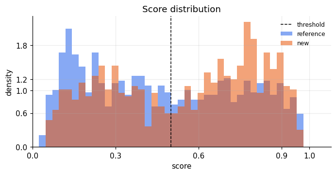
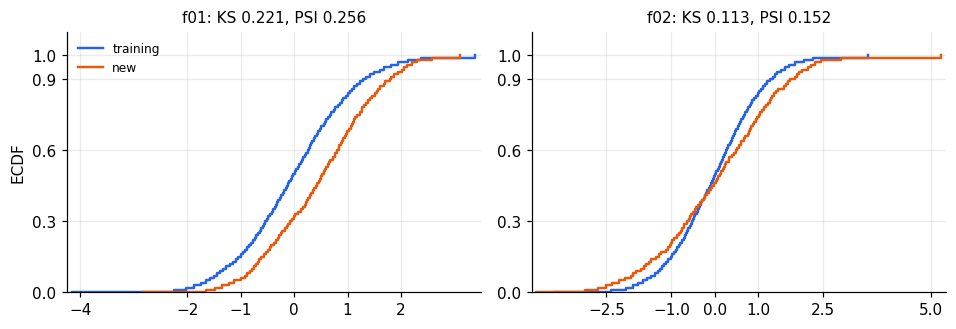
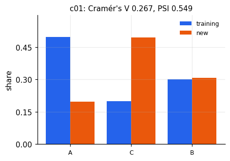

# Population drift: performance on the new data

Reference 4,000 rows · new 700 rows · 2026-10-22T18:35:47+00:00

## Expectation

> **Verdict (within):** Within expectation
>
> The valid estimates sit inside the tolerance. This is not a measurement of accuracy on new labels. Score the new population only with a scheduled rerun.
New labels are absent, so a change in P(y|x) is unidentified. Every performance number below is an estimate under the assumption in its row.

Every valid performance estimate lies on the acceptable side of the tolerance.

| Item | Value |
|---|---|
| Reference rows | 4,000 |
| New rows | 700 |
| Evaluation rows | 1,000 |
| Threshold | 0.500 |
| Performance tolerance | 0.020 (absolute AUC, worse than reference) |
| Operating-rate tolerance | not set |
| Reference | evaluation set |
| Baseline rounds | 10 |

## Observed score

Pair: evaluation set vs new.

Positive rate 45.1% → **57.6%** (95% interval for the new rate 53.9%–61.2%). A rate tolerance was not fixed, so the rate does not set the headline.

Score Population Stability Index (PSI) 0.110, Kolmogorov–Smirnov statistic (KS D) 0.139. Share within 0.05 of the threshold: 8.9% → 7.0%.

## Estimated performance

Acceptable means on the better side of reference − tolerance for AUC, or reference + tolerance × |reference| for root mean squared error (RMSE). Outside means the whole interval is on the worse side. A crossing interval is imprecise, not a failure.

| Estimate | Reference | New | 95% interval | Versus bound | Assumption |
|---|---|---|---|---|---|
| Weighted AUC | 0.793 | 0.844 | 0.791–0.890 | inside | Covariate shift: P(y\|x) unchanged. Weights are OOF density ratios. The interval resamples rows and holds the weights fixed. |
| CBPE AUC | 0.815 | 0.808 | 0.799–0.817 | inside | Calibrated scores and an unchanged map from score to label. |
| Expected precision at the threshold | 0.739 | 0.751 | 0.740–0.762 | not used | Same assumption as CBPE. Shown for the operating point. The tolerance applies to AUC. |

## Why it moved

Pair: fit set vs new · evaluation set vs new.

| Feature | Direction | Effect | Share of mean \|SHAP\| | Severity |
|---|---|---|---|---|
| f01 | new mean is higher (SMD +0.50) | PSI 0.256 | 27% | severe |
| f02 | new mean is higher (SMD +0.06) | PSI 0.152 | 16% | moderate |
| c01 | category mix changed (V 0.27) | PSI 0.549 | 6% | severe |
| f07 | new mean is lower (SMD -0.03); missing rate 2.3%→14.1% (h=+0.47) | PSI 0.016 | 2% | moderate |

1 low-importance features moved. They are outside the 80% SHAP set.

- f02: 4.4% of new values are outside the training 0.5–99.5% range.

## Whether the estimate can be used

- 2 performance estimates enter the headline.
- Kish effective sample size (ESS) ratio 0.19 (192 effective rows). Below 0.10 the weighted estimate is dropped.
- Reference expected calibration error (ECE) 0.032, calibration slope 0.891. CBPE is dropped above ECE 0.05.
- Domain-classifier AUC 0.800. This is the overlap summary, not a second performance number.
- Realized reference AUC 0.793. CBPE compares estimated AUC with estimated AUC.

## What would confirm it

- About 2,040 labelled new rows (prevalence 45.0%, AUC 0.793) make a 95% AUC interval no wider than ±0.020 (Hanley and McNeil 1982). That resolves one AUC. It does not size a test of the difference from the reference. The result that overturns the headline is an AUC on the worse side of the tolerance.
- Archive decision.json, metadata.json, checksums of each input, the model file, and the code commit with this page.
- The model owner decides. A later rerun is the monitoring step. This repository does not schedule one.

## What this page leaves out

Marginal tests, kernel tests, dependence tests, support tests, and every mild signal are in `report.html`. They explain columns that did not earn a cause row. They do not change the headline on this page.

The headline compares the valid performance estimates, and the operating rate when its tolerance was fixed, with those tolerances. The size-matched baseline decides which feature movements are sampling noise. Cause rows are the model-important features that also clear adjusted significance and a moderate effect size.

## Appendix

### Tests

| Test | Reading |
|---|---|
| Chi-square | Test that two samples share one discrete distribution. Levels with expected count below 5 are merged. Adjusted p below α: the category shares differ. Also used on the joint missingness pattern. Size is Cramér's V. |
| Two-proportion z-test | Test that two samples share a rate. Used for missingness, the predicted positive rate, and the share of scores within 0.05 of the threshold. Adjusted p below α: the rates differ. Size is Cohen's h. |
| Permutation test | Shuffle the population label and recompute the statistic. p = (1 + shuffles at least as large) / (1 + shuffles). Used for domain-classifier AUC, MMD², energy distance, and the Spearman-matrix Frobenius norm. |
| Mann–Whitney | Test that domain-classifier scores are higher for new rows than for training rows. For fixed scores this is the same comparison as AUC. The verdict uses the permutation p, because the scores were fitted on these rows. |
| Fisher z | Test that one Spearman correlation differs between the samples. The z variance is 1.06/(n−3) in each sample (Fieller, Hartley, and Pearson 1957). Adjusted p below α: that pair changed. |
| Binomial test | One-sided test that the new share outside the training 0.5–99.5% range, or the isolation-forest outlier share, exceeds the share expected from the training rule. Adjusted p below α: more new rows fall outside support. |
| Baseline empirical p | Share of random reference splits at least as large as the new population: (1 + such rounds) / (1 + rounds). Beyond baseline means the statistic exceeds that reference's 95th percentile. |

### Magnitudes

| Acronym | Meaning | Reading |
|---|---|---|
| KS D | Kolmogorov–Smirnov statistic | Largest vertical gap between the two ECDFs, from 0 to 1. 0.20 means the cumulative shares differ by 20 percentage points at that gap. Distance only: no sign, and it does not separate a mean shift from a spread or tail change. ≥ 0.10 moderate, ≥ 0.20 large, and only with adjusted p below α and a value above the baseline 95th percentile. The same reading applies to score KS D and SHAP KS D. |
| PSI | Population Stability Index | Change in bin shares. Below 0.10 stable, 0.10–0.25 monitor, above 0.25 large. |
| SMD | standardized mean difference | Mean gap divided by pooled SD. Absolute SMD ≥ 0.10 small, ≥ 0.50 large. |
| ECE | expected calibration error | Mean gap between predicted probability and observed rate. Above 0.05, probabilities are off and CBPE is info. |
| ESS | effective sample size | Kish ratio after weighting. Above 0.50 usable, 0.10–0.50 caution, below 0.10 the weights have collapsed. |
| ECDF | empirical cumulative distribution function | Share of rows at or below a value. A sideways gap is a location shift; a steeper curve is a tighter spread. |

| Statistic | Reading |
|---|---|
| Energy distance | Euclidean distance between the two joint samples. Twice the typical training–new pair distance minus the typical distance inside each group. 0 means indistinguishable; larger means the clouds are farther apart or have different spreads. Reacts more to large location or scale shifts than MMD². Cannot be severe. |

### Scores

| Acronym | Meaning | Reading |
|---|---|---|
| AUC | area under the curve | Area under the ROC curve. 0.5 means no separation. Domain classifier: ≤ 0.55 mild, ≤ 0.80 moderate, above 0.80 severe. |
| SHAP | Shapley additive explanations | A feature's additive contribution to one score. Mean absolute SHAP rank correlation below 0.80: the ranking of reasons changed. |
| OOF | out-of-fold | Score from a model that did not train on that row. |

### Estimates

| Acronym | Meaning | Reading |
|---|---|---|
| CBPE | confidence-based performance estimation | Expected metric if labels were drawn from the predicted probabilities. Requires calibrated scores. |
| RMSE | root mean squared error | Square root of mean squared error. Larger is worse. |
