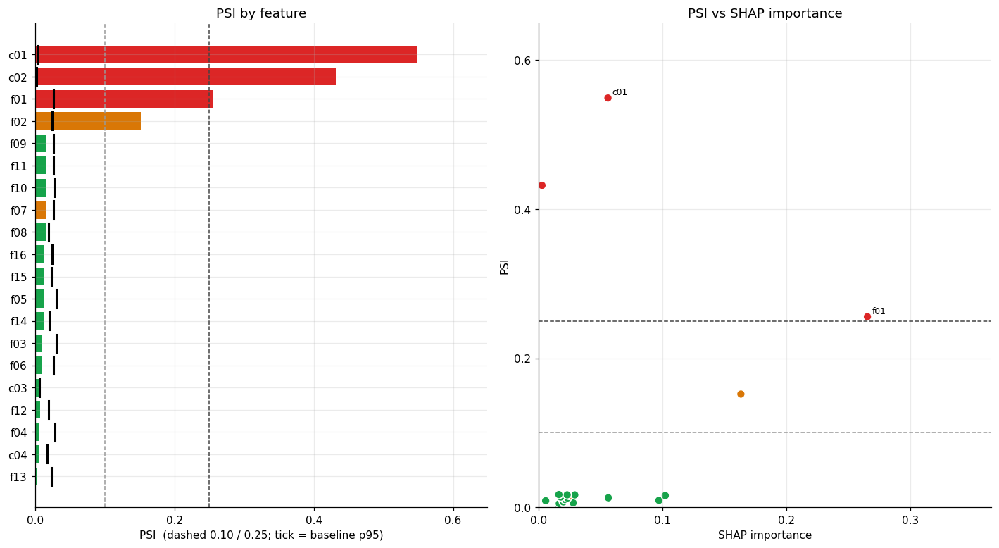
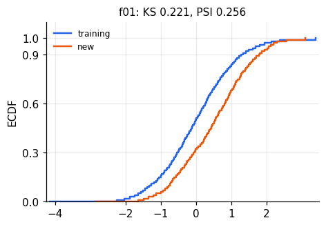
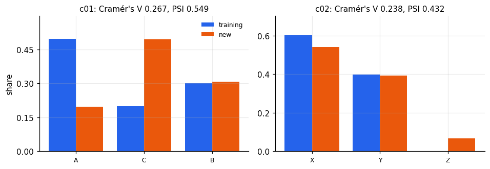
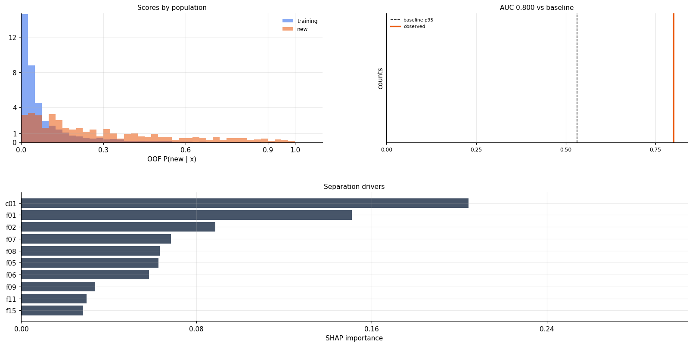
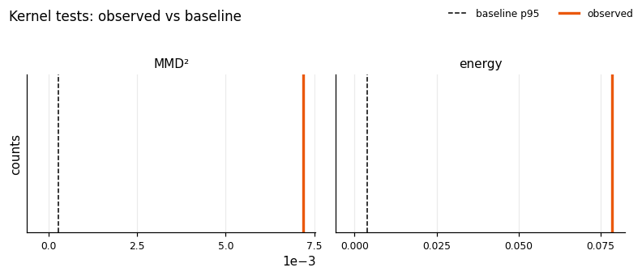
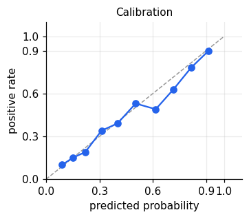

# Population drift: decision brief

Training population (4,000 rows) vs new population (700 rows) · analysis run 2026-10-22T18:35:47+00:00

## Decision

> **Verdict (severe):** Different: do not use the model as is
>
> severe if any severe signal; mild if no severe, ≤2 moderate and none on model-important features; moderate otherwise. Whether a given feature vector still maps to the same label cannot be assessed without labels.
Training: **4,000** · New: **700** · 20 features (16 continuous) · Model: **yes** · Baseline: **10** × **700**-row subsets

> **Action.** Do not score the new population with this model as-is. Investigate the severe signals, then retrain, recalibrate, or restrict scoring to in-support rows.

### Limits
- Without labels on the new population, **concept shift** (a change in P(y|x)) cannot be detected. Performance numbers below are estimates under stated assumptions.
- Full tables, methods, and baseline diagnostics: `report.html`.

## Signals that drive the verdict

A signal enters the verdict only when it is significant after multiple-testing correction, beyond the baseline 95th percentile, and at least moderate by effect size. **mild** noise or negligible · **moderate** real, moderate · **severe** real, large. `info` rows are reported, not counted.

| Level | Signal | Pair | Observed | Baseline |
|---|---|---|---|---|
| **severe** | Feature drift: model-important features | fit set vs new | 2 severe, 2 moderate of 9 | p95 per feature |
| **severe** | Joint distribution: classifier two-sample test | fit set vs new | AUC 0.800 (permutation p=0.048) | AUC p95 0.532 |
| **severe** | Out-of-support rows (Isolation Forest) | fit set vs new | 5.3% of target rows (expected 1%) | out-of-support share p95 2.2% |
| **moderate** | Feature drift: low-importance features | fit set vs new | 1 of 11 flagged | p95 per feature |
| **moderate** | Missing-value rates | fit set vs new | 1 feature(s) with \|h\| ≥ 0.2 | \|Cohen's h\| p95 per feature |
| **moderate** | Unseen category levels | fit set vs new | 1 feature(s) > 1% of rows | Unseen-level share 1.0% |
| **moderate** | Joint distribution: kernel/energy tests | fit set vs new | MMD² 0.0072 (p=0.010); energy 0.0784 (p=0.010) | MMD² p95 2.7e-04 · energy distance p95 0.00372 |
| **moderate** | Dependence structure (Spearman) | fit set vs new | Frobenius 0.901 (p=0.010) | Frobenius p95 0.495 |
| **moderate** | Values outside the training range | fit set vs new | 1 feature(s) > 2× expected | outside-share p95 per feature |
| **moderate** | Model score distribution | evaluation set vs new | score PSI 0.110, KS D 0.139 | score PSI p95 0.065 · score KS D p95 0.0764 |
| **moderate** | Predicted positive rate | evaluation set vs new | 45.1% → 57.6% | \|Cohen's h\| 0.2 |
| **moderate** | Model attributions (SHAP) | evaluation set vs new | importance rank ρ=0.99; 3 important feature(s) with shifted SHAP | 1 − rank ρ p95 0.0259 · SHAP KS D p95 per feature |
| **moderate** | Population overlap (ESS) | evaluation set vs new | ESS ratio 0.19 | ESS ratio 0.5 and 0.1 |
| **moderate** | Class prior (BBSE) | evaluation set vs new | 45.0% → 74.7% [63.4%–85.7%] | Source prevalence 45.0% |
| **mild** | Estimated performance: importance weighting | evaluation set vs new | AUC 0.844 [95% CI 0.791–0.890] vs reference 0.793 | Reference AUC 0.793; tolerance 0.02 |
| **mild** | Estimated performance: CBPE | evaluation set vs new | AUC 0.808 [95% CI 0.799–0.817] vs reference 0.815 | Reference AUC 0.815; tolerance 0.02 |
| **info** | Source calibration (prerequisite for CBPE) | evaluation set vs new | ECE 0.032, slope 0.89 | ECE 0.05 |

## Feature evidence

Pair: fit set vs new.

**3** severe, **2** moderate, **15** mild of 20 features. Model-important features are the smallest TreeSHAP set reaching 80% of mean |SHAP|.

| feature | type | severity | important | PSI | KS D | SMD | Cramér's V | reasons |
|---|---|---|---|---|---|---|---|---|
| c01 | categorical | **severe** | yes | 0.549 | – | – | 0.267 | PSI=0.549; Cramér's V=0.267; adj. p

## Model and performance evidence

Pair: fit set vs new · evaluation set vs new.

The score plot overlays out-of-fold (OOF) P(new | x) for training (blue) and new (orange) rows. Separated masses mean a function of the features can tell the populations apart; overlapping masses mean it cannot. The AUC panel places the observed AUC (orange) on the grey baseline histogram; the dashed line is the 95th percentile of sampling noise.

A LightGBM classifier trained to tell the populations apart reaches an OOF AUC of **0.800** [0.774–0.815], permutation p = 0.048; the baseline 95th percentile is 0.532. An AUC near 0.5 means indistinguishable; 0.55–0.65 mild, 0.65–0.80 moderate, > 0.80 strong shift. TreeSHAP on that classifier ranks **c01, f01, f02** as the main drivers. A low AUC can still hide a moderate shift in a single feature, so read it together with the feature table.

These distances measure whether the two clouds of rows occupy the same region of joint feature space, not one column at a time. They do not depend on trees. Zero: indistinguishable. Larger: the joint distributions differ. Neither can make the verdict severe.

MMD² (radial basis function (RBF) kernel, median-distance bandwidth) compares local neighborhoods: new rows should sit near training rows. Similarity saturates beyond the bandwidth, so it does not grow with how far a shift went. Grey bars are the baseline (random training splits); the dashed line is that baseline's 95th percentile; the orange line is the observed value. The observed value 0.00718 sits to the right of the percentile 2.7e-04, so this distance exceeds sampling noise (permutation p = 0.0099).

Energy distance uses raw Euclidean geometry: a random training–new pair should be about as far apart as a pair from the same group. It reacts more to large location or scale shifts than MMD². Grey bars are the baseline (random training splits); the dashed line is that baseline's 95th percentile; the orange line is the observed value. The observed value 0.0784 sits to the right of the percentile 0.00372, so this distance exceeds sampling noise (permutation p = 0.0099).

| test | statistic | permutation p | rows used (training/new) |
|---|---|---|---|
| MMD² (RBF kernel) | 0.00718 | 0.0099 | 2,000 / 700 |
| Energy distance | 0.0784 | 0.0099 | 2,000 / 700 |

Score PSI 0.110; KS D 0.139; positive rate 45.1% → **57.6%**.

SHAP importance rank Spearman ρ = 0.99 (below 0.80 means the ranking of reasons changed).

> **How reference and estimate are found.** Neither value uses labels on the new population.- **Importance weighting.** The reference is the unweighted metric on labelled reference rows. The estimate is the same metric after those rows are reweighted by a domain-classifier density ratio so their feature mix matches the new population. The interval bootstraps the labelled rows with those weights. New rows contribute features only, not labels. Assumes covariate shift: P(y|x) unchanged.
> - **CBPE.** Each score is treated as P(y=1|x). The reference is the expected metric if labels were drawn from the reference predicted probabilities. The estimate is the same functional on the new predicted probabilities. The interval bootstraps the new scores. Assumes calibrated probabilities and no concept shift. The reference is not the labelled (realized) metric.
>  If the methods disagree, treat the result as inconclusive.

importance weighting: estimated AUC **0.844** [0.791–0.89] vs reference 0.793.

CBPE: estimated AUC **0.808** [0.799–0.817] vs reference 0.815.

## Appendix

### Tests

| Test | Reading |
|---|---|
| Chi-square | Test that two samples share one discrete distribution. Levels with expected count below 5 are merged. Adjusted p below α: the category shares differ. Also used on the joint missingness pattern. Size is Cramér's V. |
| Two-proportion z-test | Test that two samples share a rate. Used for missingness, the predicted positive rate, and the share of scores within 0.05 of the threshold. Adjusted p below α: the rates differ. Size is Cohen's h. |
| Permutation test | Shuffle the population label and recompute the statistic. p = (1 + shuffles at least as large) / (1 + shuffles). Used for domain-classifier AUC, MMD², energy distance, and the Spearman-matrix Frobenius norm. |
| Mann–Whitney | Test that domain-classifier scores are higher for new rows than for training rows. For fixed scores this is the same comparison as AUC. The verdict uses the permutation p, because the scores were fitted on these rows. |
| Fisher z | Test that one Spearman correlation differs between the samples. The z variance is 1.06/(n−3) in each sample (Fieller, Hartley, and Pearson 1957). Adjusted p below α: that pair changed. |
| Binomial test | One-sided test that the new share outside the training 0.5–99.5% range, or the isolation-forest outlier share, exceeds the share expected from the training rule. Adjusted p below α: more new rows fall outside support. |
| Baseline empirical p | Share of random reference splits at least as large as the new population: (1 + such rounds) / (1 + rounds). Beyond baseline means the statistic exceeds that reference's 95th percentile. |

### Magnitudes

| Acronym | Meaning | Reading |
|---|---|---|
| KS D | Kolmogorov–Smirnov statistic | Largest vertical gap between the two ECDFs, from 0 to 1. 0.20 means the cumulative shares differ by 20 percentage points at that gap. Distance only: no sign, and it does not separate a mean shift from a spread or tail change. ≥ 0.10 moderate, ≥ 0.20 large, and only with adjusted p below α and a value above the baseline 95th percentile. The same reading applies to score KS D and SHAP KS D. |
| PSI | Population Stability Index | Change in bin shares. Below 0.10 stable, 0.10–0.25 monitor, above 0.25 large. |
| SMD | standardized mean difference | Mean gap divided by pooled SD. Absolute SMD ≥ 0.10 small, ≥ 0.50 large. |
| MMD² | squared maximum mean discrepancy | Unbiased square of MMD, the stored number. Same reading as MMD: 0 indistinguishable, larger a joint-distribution shift. Cannot be severe. |
| RBF | radial basis function | Kernel used for MMD. Bandwidth is the median pairwise distance between rows. Rows closer than the bandwidth count as similar; farther rows do not. |
| ECE | expected calibration error | Mean gap between predicted probability and observed rate. Above 0.05, probabilities are off and CBPE is info. |
| ESS | effective sample size | Kish ratio after weighting. Above 0.50 usable, 0.10–0.50 caution, below 0.10 the weights have collapsed. |
| ECDF | empirical cumulative distribution function | Share of rows at or below a value. A sideways gap is a location shift; a steeper curve is a tighter spread. |

| Statistic | Reading |
|---|---|
| Energy distance | Euclidean distance between the two joint samples. Twice the typical training–new pair distance minus the typical distance inside each group. 0 means indistinguishable; larger means the clouds are farther apart or have different spreads. Reacts more to large location or scale shifts than MMD². Cannot be severe. |

### Scores

| Acronym | Meaning | Reading |
|---|---|---|
| AUC | area under the curve | Area under the ROC curve. 0.5 means no separation. Domain classifier: ≤ 0.55 mild, ≤ 0.80 moderate, above 0.80 severe. |
| SHAP | Shapley additive explanations | A feature's additive contribution to one score. Mean absolute SHAP rank correlation below 0.80: the ranking of reasons changed. |
| TreeSHAP | Shapley additive explanations from trees | SHAP for a tree model, from shap.TreeExplainer. |
| OOF | out-of-fold | Score from a model that did not train on that row. |

### Estimates

| Acronym | Meaning | Reading |
|---|---|---|
| CBPE | confidence-based performance estimation | Expected metric if labels were drawn from the predicted probabilities. Requires calibrated scores. |
| BBSE | black-box shift estimation | Estimated new class prior. Usable only if P(x given y) is unchanged. |
| CI | confidence interval | Range for an estimate. Performance is severe only when the whole interval lies past the tolerance. |
